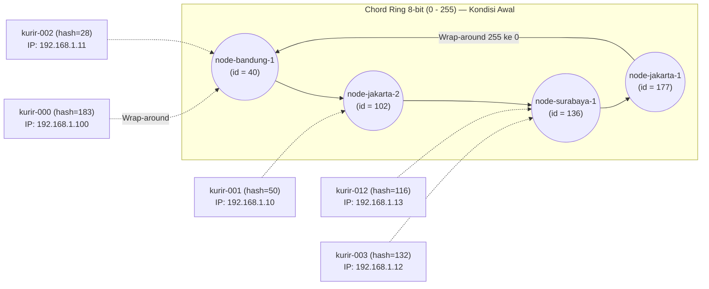
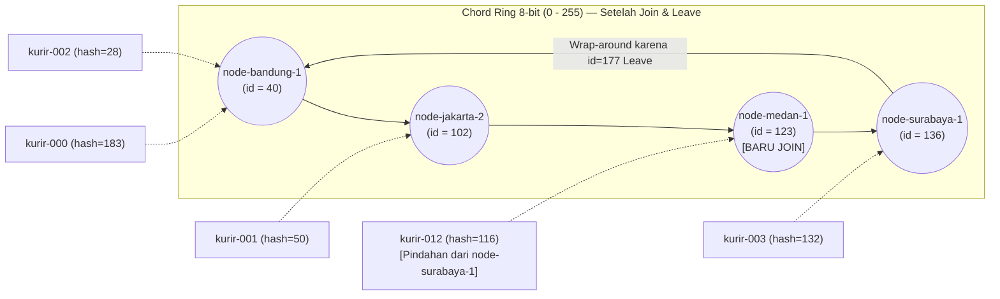

# Tugas 6 (Pekan 6) — Penamaan & Resolusi Lokasi

**Materi terkait:** Flat Naming, Structured Naming (DNS), Distributed Hash Table (DHT)/Chord.

## Studi Kasus

Pelanggan FoodGo kesulitan menemukan alamat IP server kurir yang **dinamis** (kurir berpindah lokasi/jaringan, IP-nya sering berubah). FoodGo butuh cara memetakan **ID Kurir** (identitas tetap) ke **alamat IP terkininya** tanpa server pusat tunggal yang jadi bottleneck/single point of failure.

## Tugas Kelompok

Implementasikan **simulasi Chord DHT** sederhana (single-process, tidak perlu jaringan sungguhan — cukup simulasi struktur data & algoritma di satu program Python) yang memetakan ID Kurir ke alamat IP mereka.

Konsep yang harus terlihat jalan dalam simulasi kalian:
1. **Consistent hashing**: ID Kurir dan ID Node di-hash ke ruang angka yang sama (mis. 0–255 untuk kesederhanaan, `m=8` bit).
2. **Ring topology**: node-node diurutkan melingkar berdasarkan hasil hash-nya.
3. **Lookup**: fungsi `lookup(kurir_id)` yang menemukan node mana yang bertanggung jawab menyimpan mapping ID Kurir tersebut → alamat IP-nya (aturan Chord: node dengan ID hash **terkecil yang lebih besar atau sama dengan** hash key, disebut *successor*).
4. **Perubahan topologi**: simulasikan minimal satu node baru bergabung (`join`) atau satu node keluar (`leave`), tunjukkan bagaimana mapping berpindah tanggung jawab ke node lain.

Skeleton disediakan di `src/chord_simulation.py` dengan fungsi hashing dan struktur ring sudah ada — bagian `lookup()`, `join()`, dan `leave()` sengaja dikosongkan.

### Cara Menjalankan

```bash
python3 src/chord_simulation.py
```

## Tugas Analisis (`README.md`)

1. Jelaskan **kenapa DHT/Chord** lebih cocok untuk kasus ini dibanding **flat naming sederhana** (mis. tabel pusat ID→IP) atau **DNS konvensional** — kaitkan dengan sifat "IP kurir sering berubah" dan kebutuhan tanpa titik gagal tunggal.
2. Gambarkan (boleh pakai Mermaid, lihat Tugas 2) ring topology dari simulasi kalian, tandai node mana yang bertanggung jawab atas ID Kurir mana.
3. Jelaskan apa yang terjadi pada mapping saat sebuah node **keluar** dari ring (siapa yang mengambil alih tanggung jawabnya) — dukung dengan output program.

## Struktur Submission

```
tugas-06-penamaan-dht/
├── README.md      # Analisis + diagram ring
├── JURNAL.md
├── src/
│   └── chord_simulation.py
└── bukti/          # Output program (screenshot/log) untuk skenario join & leave
```

## Rubrik Penilaian (Tugas 6)

| Komponen | Bobot | Kriteria |
|---|---|---|
| Implementasi lookup/join/leave benar | 35% | Consistent hashing & successor lookup sesuai aturan Chord |
| Bukti perubahan topologi (join/leave) | 25% | Output menunjukkan mapping berpindah dengan benar |
| Analisis kenapa DHT vs flat naming/DNS | 25% | Argumen spesifik ke kasus IP kurir dinamis, bukan definisi umum |
| Proses & kontribusi kelompok | 15% | `JURNAL.md`, commit history |

## Batasan Penggunaan AI (Level 2)

Kebijakan **Level 2 (AI Assisted Idea Generation & Structuring)** berlaku — lihat [`../RUBRIK-UMUM.md`](../RUBRIK-UMUM.md). Boleh bertanya konsep umum consistent hashing/Chord ke AI; **tidak boleh** meminta AI menuliskan isi `# TODO` di `src/chord_simulation.py` (`find_successor`, `join`, `leave`, dst). Catat pemakaian AI di "Log Penggunaan AI" pada `JURNAL.md`.

- `README.md` wajib menelusuri manual (langkah demi langkah) bagaimana `lookup()` menemukan successor untuk salah satu ID Kurir contoh yang dipakai di `chord_simulation.py` — bukan cuma menempelkan output program.

## Jawaban Tugas Analisis

### 1. Kenapa DHT/Chord Lebih Cocok Dibanding Flat Naming atau DNS Konvensional(Haniel Juanta)

Pada studi kasus FoodGo, kendala utamanya adalah kurir terus bergerak di jalan untuk mengantar pesanan dan sering berpindah jaringan (misalnya dari Wi-Fi ke data seluler atau berpindah jangkauan BTS), sehingga alamat IP perangkat kurir berubah-ubah dalam hitungan menit. Di sisi lain, pelanggan tetap harus bisa melacak kurir hanya dengan menggunakan ID Kurir yang sifatnya tetap.

Jika FoodGo menggunakan pendekatan **flat naming sederhana** seperti satu tabel atau database terpusat yang menyimpan mapping `ID Kurir -> IP`, seluruh beban sistem akan menumpuk di satu server tersebut. Ketika banyak kurir berpindah lokasi dan memperbarui alamat IP mereka secara bersamaan, ditambah pelanggan yang terus melakukan request lokasi kurir, server pusat ini akan mengalami *bottleneck* karena seluruh proses baca dan tulis tertuju ke satu titik yang sama. Selain itu, penggunaan tabel pusat memiliki risiko *single point of failure* (SPOF), di mana jika server pusat tersebut mengalami gangguan atau mati, maka seluruh fitur pelacakan kurir FoodGo akan langsung berhenti total.

Penggunaan **DNS konvensional** juga tidak cocok untuk kondisi alamat IP yang berubah setiap beberapa menit. Walaupun DNS memiliki struktur hierarki, cara kerja DNS sangat mengandalkan mekanisme *caching* dan batas waktu simpan atau *Time-To-Live* (TTL). Apabila alamat IP kurir berganti dalam waktu singkat, pelanggan akan sering mendapatkan alamat IP kurir yang lama karena data lama masih tertahan di *cache* DNS lokal. Sebaliknya, jika nilai TTL diatur menjadi sangat kecil atau 0 agar selalu mengambil data terbaru, manfaat *caching* pada DNS akan hilang dan server DNS pusat milik FoodGo tetap akan kebanjiran trafik *update* maupun *query* secara terus-menerus.

Oleh karena itu, **Chord DHT** jauh lebih cocok untuk kasus FoodGo karena penyimpanan mapping `ID Kurir -> IP` disebar ke banyak node yang disusun melingkar (*ring topology*) menggunakan *consistent hashing* tanpa bergantung pada satu server pusat. Saat alamat IP seorang kurir berubah, pembaruan data (`register_kurir`) cukup diarahkan ke satu node penanggung jawab (*successor*) yang nilai hash-nya paling dekat dan lebih besar atau sama dengan nilai hash ID kurir tersebut. Dengan cara ini, beban update IP dan pencarian (*lookup*) terbagi ke berbagai node yang ada di ring, serta pencarian di jaringan Chord dapat dilakukan secara efisien dengan kompleksitas O(log N). Sistem ini juga menghindari *single point of failure*, karena jika salah satu node tiba-tiba keluar dari jaringan atau mati (`leave`), tanggung jawab data kurir yang dipegangnya akan langsung diambil alih oleh node *successor* berikutnya di dalam ring.

#### Penelusuran Manual Proses `lookup("kurir-001")`:
Untuk melihat bagaimana fungsi `lookup()` pada `src/chord_simulation.py` menemukan node penanggung jawab di ruang hash 8-bit (`0` sampai `255`), berikut adalah urutan langkahnya saat mencari `"kurir-001"`:

1. Pada skenario awal, empat node (`node-jakarta-1`, `node-jakarta-2`, `node-bandung-1`, dan `node-surabaya-1`) bergabung ke dalam ring. Nama masing-masing node diubah menjadi angka di rentang `0–255` melalui fungsi `hash_id()` menggunakan SHA-1 modulo 256, lalu disimpan ke dalam dictionary `self.nodes`.
2. Ketika kurir pertama didaftarkan melalui `ring.register_kurir("kurir-001", "192.168.1.10")`, string `"kurir-001"` diubah dulu menjadi nilai hash melalui `key_hash = hash_id("kurir-001")`. Fungsi tersebut lalu mencari node penanggung jawabnya lewat `find_successor(key_hash)` dan menyimpan pasangan `("kurir-001", "192.168.1.10")` pada `self.data[key_hash]`.
3. Saat `ring.lookup("kurir-001")` dipanggil untuk mencari IP kurir, program kembali menghitung `key_hash = hash_id("kurir-001")` dan memanggil `self.find_successor(key_hash)`.
4. Di dalam `find_successor(key_hash)`, program memeriksa seluruh ID node yang ada pada `self.nodes.keys()` dan menyaring node mana saja yang memenuhi syarat aturan Chord `nid >= key_hash` ke dalam variabel `candidates`.
5. Apabila terdapat satu atau lebih node di dalam `candidates`, program memilih node dengan nilai hash paling kecil menggunakan `min(candidates)` sebagai *successor*. Namun, jika nilai `key_hash` milik `"kurir-001"` ternyata lebih besar daripada seluruh ID node yang ada di ring (sehingga `candidates` kosong), fungsi akan melakukan *wrap-around* kembali ke titik awal lingkaran dengan mengambil nilai paling kecil dari seluruh node melalui `min(self.nodes.keys())`.
6. Setelah `successor_id` ditemukan, fungsi `lookup()` mengecek apakah `key_hash` milik `"kurir-001"` tersimpan di dalam `self.data`. Karena datanya ada, program mengambil alamat IP dari tuple `self.data[key_hash]` dan mengembalikan IP terkini milik `"kurir-001"`, yaitu `192.168.1.10`.

---

### 2. Diagram Ring Topology dan Node (Farrelino)
Pada simulasi ini digunakan ruang hash 8-bit (`0–255`). Setiap node bertanggung jawab atas rentang key `(predecessor_id, node_id]` secara searah jarum jam (*clockwise*).

#### a. Kondisi Awal Ring (4 Node & Mapping 5 Kurir)

Urutan node pada ring berdasarkan nilai hash (dari terkecil ke terbesar):
1. **`node-bandung-1` (`id=40`)**: Menangani rentang hash `(177, 255]` dan `[0, 40]` (*wrap-around*). Menyimpan **`kurir-000` (`hash=183`)** dan **`kurir-002` (`hash=28`)**.
2. **`node-jakarta-2` (`id=102`)**: Menangani rentang hash `(40, 102]`. Menyimpan **`kurir-001` (`hash=50`)**.
3. **`node-surabaya-1` (`id=136`)**: Menangani rentang hash `(102, 136]`. Menyimpan **`kurir-012` (`hash=116`)** dan **`kurir-003` (`hash=132`)**.
4. **`node-jakarta-1` (`id=177`)**: Menangani rentang hash `(136, 177]`.



#### b. Kondisi Ring Setelah Perubahan Topologi (`node-medan-1` Join & `node-jakarta-1` Leave)

- **Saat `node-medan-1` (`id=123`) bergabung (`join`):** Node ini masuk di antara `node-jakarta-2` (`id=102`) dan `node-surabaya-1` (`id=136`). Rentang `(102, 123]` diambil alih oleh `node-medan-1`, sehingga **`kurir-012` (`hash=116`)** berpindah dari `node-surabaya-1` ke `node-medan-1`, sedangkan `kurir-003` (`hash=132`) tetap berada di `node-surabaya-1`.
- **Saat `node-jakarta-1` (`id=177`) keluar (`leave`):** Tanggung jawab rentang `(136, 177]` diserahkan ke successor berikutnya searah jarum jam (*wrap-around*), yaitu **`node-bandung-1` (`id=40`)**.



| ID Kurir | Hash Key | Node Awal (4 Node) | Setelah `node-medan-1` (`id=123`) Join | Setelah `node-jakarta-1` (`id=177`) Leave |
|---|---|---|---|---|
| `kurir-002` | `28` | `node-bandung-1` (`id=40`) | `node-bandung-1` (`id=40`) | `node-bandung-1` (`id=40`) |
| `kurir-001` | `50` | `node-jakarta-2` (`id=102`) | `node-jakarta-2` (`id=102`) | `node-jakarta-2` (`id=102`) |
| `kurir-012` | `116` | `node-surabaya-1` (`id=136`) | **`node-medan-1` (`id=123`)** *(Pindah)* | `node-medan-1` (`id=123`) |
| `kurir-003` | `132` | `node-surabaya-1` (`id=136`) | `node-surabaya-1` (`id=136`) | `node-surabaya-1` (`id=136`) |
| `kurir-000` | `183` | `node-bandung-1` (`id=40`) | `node-bandung-1` (`id=40`) | `node-bandung-1` (`id=40`) |

---

### 3. Mekanisme Saat Node Keluar (Leave) dari Ring(Nuevalen)

Ketika sebuah node keluar (`leave`) dari jaringan Chord Ring, node tersebut tidak boleh langsung menghapus atau menghilangkan data mapping `ID Kurir -> IP` yang sedang dipegangnya. Sesuai aturan *consistent hashing* pada Chord, seluruh key yang sebelumnya menjadi tanggung jawab node yang keluar harus diserahkan (*migrasi*) kepada **successor berikutnya** di dalam ring (yaitu node aktif dengan ID terkecil yang lebih besar dari key tersebut, atau *wrap-around* ke node dengan ID terkecil di ring apabila tidak ada lagi node dengan ID yang lebih besar).

Secara algoritma pada fungsi `leave(node_name)` di `src/chord_simulation.py`, proses yang terjadi saat `node-jakarta-1` keluar adalah:
1. Program mengidentifikasi `node_id` dari node yang akan keluar (`node-jakarta-1` memiliki `id=177`), lalu mencari seluruh key kurir di `self.data` yang memiliki `owner_id == 177` ke dalam list `keys_to_move`.
2. Node `177` dihapus dari daftar node aktif (`del self.nodes[177]`), sehingga node yang tersisa di ring adalah `node-bandung-1` (`40`), `node-jakarta-2` (`102`), `node-medan-1` (`123`), dan `node-surabaya-1` (`136`).
3. Untuk setiap key di dalam `keys_to_move`, program mencari successor baru di antara node yang tersisa. Karena key yang tadinya berada di `node-jakarta-1` berada di rentang `(136, 177]` (lebih besar daripada ID node tertinggi yang tersisa yaitu `136`), maka pencarian kandidat `nid >= k` menghasilkan list kosong dan program mengeksekusi *fallback wrap-around* `min(self.nodes.keys())`, yaitu **`node-bandung-1` (`id=40`)**.
4. Akibatnya, rentang tanggung jawab `node-bandung-1` (`id=40`) melebar dari semula `(177, 255] U [0, 40]` menjadi **`(136, 255] U [0, 40]`**.

#### Bukti Output Program (`chord_simulation.py`):
```text
=== Skenario Leave: Node Keluar ===
[Node] 'node-jakarta-1' (id=177) keluar dari ring

--- Lookup setelah Leave ---
[Lookup] kurir-000 (hash=183) ditemukan di node-bandung-1 -> 192.168.1.100
[Lookup] kurir-001 (hash=50) ditemukan di node-jakarta-2 -> 192.168.1.10
```
Pada output di atas, ketika `node-jakarta-1` (`id=177`) keluar dari ring, tanggung jawab segmennya diambil alih oleh successor searah jarum jam yaitu `node-bandung-1` (`id=40`). Pemanggilan `lookup("kurir-000")` (`hash=183`) tetap berhasil diarahkan via *wrap-around* ke `node-bandung-1` (`192.168.1.100`), dan `lookup("kurir-001")` (`hash=50`) tetap berada di `node-jakarta-2` (`192.168.1.10`) tanpa ada data yang hilang.
