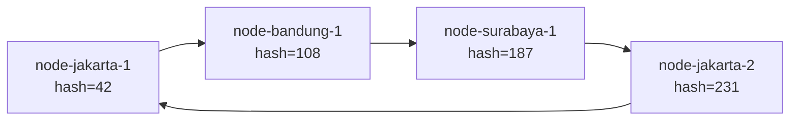

# 📘 Instruction — Tugas 6: Penamaan & Resolusi Lokasi (Chord DHT)

**Kelompok:** [Isi Nama Kelompok]  
**Target Selesai:** [Isi Tanggal, misal: H-2 sebelum deadline]  
**Fokus Utama:** Simulasi Chord DHT untuk memetakan ID Kurir → IP dinamis tanpa single point of failure.

---

## 🎯 Tujuan Pembelajaran

1. Memahami **consistent hashing** dan **ring topology** di Chord DHT.
2. Mengimplementasikan operasi inti: `find_successor`, `join`, `leave`, `lookup`.
3. Menganalisis kenapa DHT lebih cocok untuk kasus **IP kurir dinamis** dibanding flat naming atau DNS.

---

## 👥 Pembagian Tugas yang Adil

Setiap anggota mendapat **3 tanggung jawab seimbang**:
- 🧩 **Coding** (implementasi TODO di `chord_simulation.py`)
- 🧪 **Testing** (eksekusi skenario tertentu & ambil bukti)
- 📝 **Dokumentasi** (menulis bagian spesifik di README/JURNAL)

| Nama | NIM | 🧩 Coding (TODO) | 🧪 Testing Skenario | 📝 Dokumentasi |
| :--- | :--- | :--- | :--- | :--- |
| **Nuevalen Refitra Alswanfo** | 103072430008 | `register_kurir()` (TODO 7) + `lookup()` (TODO 8) — operasi data | **Skenario Leave**: Node `node-jakarta-1` keluar, verifikasi data berpindah ke successor | **README bagian 3**: Penjelasan mekanisme `leave` + **JURNAL.md** lengkap |
| **Haniel Juanta Sembiring** | 103072400145 | `find_successor()` (TODO 6) — jantung algoritma Chord | **Skenario Awal**: 4 node join + register 3 kurir, verifikasi lookup bekerja | **README bagian 1**: Analisis "Kenapa DHT vs flat naming/DNS" (kaitkan ke kasus IP kurir dinamis) |
| **FARRELLINO ULUNG SATYA AMANDO** | 103072400005 | `join()` (TODO 1,2,3) + `leave()` (TODO 4,5) — perubahan topologi | **Skenario Join**: Node baru `node-medan-1` bergabung, verifikasi data berpindah tanggung jawab | **README bagian 2**: Diagram ring topology (Mermaid) + penjelasan node penanggung jawab |

### ⚖️ Kenapa Pembagian Ini Adil?

1. **Beban coding seimbang**: Nuevalen (2 fungsi operasi data), Haniel (1 fungsi inti yang kompleks), Farrellino (2 fungsi perubahan topologi).
2. **Setiap orang testing skenario berbeda**: tidak ada yang cuma "run program".
3. **Setiap orang menulis bagian README berbeda**: tidak ada yang cuma ngerjain dokumentasi.
4. **Ketergantungan logis**: `find_successor` (Haniel) dibutuhkan oleh `join/leave` (Farrellino) dan `register/lookup` (Nuevalen) → kerja sama tim wajib.

---

## 🔄 Alur Kerja (Workflow)

### Langkah 1: Pahami Konsep Dasar (30 menit, SEMUA ANGGOTA)
Baca bersama:
- **Consistent hashing**: ID node & ID kurir di-hash ke ruang 0–255 (8 bit).
- **Ring topology**: node diurutkan melingkar berdasarkan hash.
- **Successor rule**: node dengan hash **terkecil yang ≥ key hash** adalah penanggung jawab. Jika tidak ada, wrap-around ke node dengan hash terkecil.

### Langkah 2: Kerja Individu — Coding (1–2 Hari)

> ⚠️ **Catatan:** Haniel disarankan menyelesaikan `find_successor` terlebih dahulu, karena fungsi ini dibutuhkan oleh Nuevalen dan Farrellino.

#### 🧩 Nuevalen — `register_kurir()` (TODO 7) + `lookup()` (TODO 8)
```python
def register_kurir(self, kurir_id: str, ip_kurir: str):
    key_hash = hash_id(kurir_id)
    successor = self.find_successor(key_hash)
    self.data[key_hash] = (kurir_id, ip_kurir)
    # Simpan juga info successor-nya untuk tracking (opsional)

def lookup(self, kurir_id: str) -> str | None:
    key_hash = hash_id(kurir_id)
    successor = self.find_successor(key_hash)
    if key_hash in self.data:
        return self.data[key_hash][1]  # return ip_kurir
    return None
```
**Tips:** Pastikan `register_kurir` dipanggil SETELAH semua node join, supaya successor sudah stabil.

#### 🧩 Haniel — `find_successor()` (TODO 6)
```python
def find_successor(self, key_hash: int) -> int:
    # Cari node_id TERKECIL yang >= key_hash
    # Jika tidak ada, wrap-around ke node dengan hash terkecil
    candidates = [nid for nid in self.nodes.keys() if nid >= key_hash]
    if candidates:
        return min(candidates)
    return min(self.nodes.keys())  # wrap-around
```
**Tips:** Ini fungsi paling kritis. Test manual dengan print hasil hash beberapa node dulu.

#### 🧩 Farrellino — `join()` (TODO 1,2,3) + `leave()` (TODO 4,5)
```python
def join(self, node_name: str, node_ip: str):
    node_id = hash_id(node_name)
    # 1. Tambahkan ke self.nodes
    # 2. Cari successor LAMA (sebelum node ini masuk) — sementara hapus node_id dari self.nodes saat mencari
    # 3. Pindahkan data dari successor lama ke node baru (key dengan hash <= node_id)
    
def leave(self, node_name: str):
    node_id = hash_id(node_name)
    # 1. Hapus dari self.nodes
    # 2. Cari successor BARU untuk tiap key yang dipegang node ini
    # 3. Pindahkan data ke successor baru
```
**Tips:** Untuk `join`, sementara hapus `node_id` dari `self.nodes` sebelum panggil `find_successor`, supaya tidak menemukan dirinya sendiri.

### Langkah 3: Integrasi & Testing (45–60 menit, SEMUA ANGGOTA)

Lakukan sesi **live testing bersama** (screen share atau 1 ruangan):

#### 🧪 Nuevalen — Test Skenario Leave
```bash
python3 src/chord_simulation.py
```
**Yang harus diverifikasi:**
- Saat `node-jakarta-1` leave, log menunjukkan data dipindahkan ke successor.
- `kurir-001` dan `kurir-002` masih bisa di-lookup (di node lain).
- **Ambil screenshot output** → simpan di `bukti/skenario_leave.png`.

#### 🧪 Haniel — Test Skenario Awal
```bash
python3 src/chord_simulation.py
```
**Yang harus diverifikasi:**
- 4 node (`node-jakarta-1/2`, `node-bandung-1`, `node-surabaya-1`) terdaftar di ring.
- `kurir-001`, `kurir-002`, `kurir-003` berhasil di-lookup → IP muncul.
- **Ambil screenshot output** → simpan di `bukti/skenario_awal.png`.

#### 🧪 Farrellino — Test Skenario Join
```bash
python3 src/chord_simulation.py
```
**Yang harus diverifikasi:**
- Saat `node-medan-1` join, log menunjukkan data berpindah tanggung jawab.
- `kurir-001` masih bisa di-lookup (mungkin di node berbeda sekarang).
- **Ambil screenshot output** → simpan di `bukti/skenario_join.png`.

### Langkah 4: Dokumentasi (1 Hari)

#### 📝 Nuevalen — README Bagian 3 + JURNAL.md
- Jelaskan mekanisme `leave`: siapa yang ambil alih data, kenapa successor yang ambil.
- Lengkapi `JURNAL.md` dengan kendala & solusi selama coding.

#### 📝 Haniel — README Bagian 1
Tulis analisis **kenapa DHT lebih cocok** untuk kasus FoodGo:
- Flat naming (tabel pusat ID→IP): bottleneck, single point of failure.
- DNS konvensional: butuh server pusat, tidak cocok untuk IP yang berubah tiap menit.
- DHT/Chord: terdistribusi, lookup O(log N), toleran kegagalan node.
- **Kaitkan spesifik ke kasus IP kurir dinamis** (bukan definisi umum).

#### 📝 Farrellino — README Bagian 2 (Diagram)
Buat diagram **Mermaid** ring topology:

Tandai node mana bertanggung jawab atas kurir mana (berdasarkan hash kurir).

### Langkah 5: Git Commit (Wajib dari Laptop Masing-Masing)

Lihat bagian **Rekomendasi Commit** di bawah.

---

## 🚀 Cara Menjalankan

```bash
# Masuk ke folder tugas
cd tugas-06-penamaan-dht

# Jalankan simulasi
python3 src/chord_simulation.py
```

**Output yang diharapkan:**
```text
[Node] 'node-jakarta-1' (id=XX) bergabung, alamat 10.0.0.1
[Node] 'node-jakarta-2' (id=XX) bergabung, alamat 10.0.0.2
...
--- Lookup sebelum perubahan topologi ---
kurir-001 -> 192.168.1.10
kurir-002 -> 192.168.1.11

--- Node baru bergabung ---
[Node] 'node-medan-1' (id=XX) bergabung, alamat 10.0.0.5
[Data] Key XXX dipindahkan dari node-jakarta-1 ke node-medan-1
kurir-001 -> 192.168.1.10

--- Sebuah node keluar ---
[Node] 'node-jakarta-1' (id=XX) keluar dari ring
[Data] Key XXX dipindahkan dari node-jakarta-1 ke node-bandung-1
kurir-001 -> 192.168.1.10
```

---

## 📁 Struktur Submission

```text
tugas-06-penamaan-dht/
├── README.md              # Analisis + diagram ring (dibagi 3 bagian)
├── JURNAL.md              # Diisi Nuevalen, di-review semua
├── src/
│   └── chord_simulation.py  # Implementasi TODO 1-8
└── bukti/
    ├── skenario_leave.png   # Nuevalen
    ├── skenario_awal.png    # Haniel
    └── skenario_join.png    # Farrellino
```

---

## 📊 Rubrik Penilaian

| Komponen | Bobot | Penanggung Jawab Utama |
|---|---|---|
| Implementasi lookup/join/leave benar | 35% | **Nuevalen** (register/lookup), **Haniel** (find_successor), **Farrellino** (join/leave) |
| Bukti perubahan topologi (join/leave) | 25% | **Nuevalen** (leave), **Farrellino** (join) |
| Analisis DHT vs flat naming/DNS | 25% | **Nuevalen** (mekanisme leave), **Haniel** (analisis), **Farrellino** (diagram) |
| Proses & kontribusi kelompok | 15% | **Semua** (commit history + JURNAL.md) |

---

## 📝 Template JURNAL.md

```markdown
# Jurnal Proses — Tugas 6

## Implementasi register_kurir & lookup
- Kesalahan pertama: [mis. lupa memastikan find_successor sudah return integer yang valid]
- Cara memperbaiki: [memastikan mapping self.data disimpan dengan key_hash yang benar]

## Implementasi find_successor
- Kesalahan pertama: [mis. lupa handle wrap-around saat key_hash > semua node_id]
- Cara memperbaiki: [tambahkan kondisi `if not candidates: return min(self.nodes.keys())`]

## Implementasi join & leave
- Kesalahan pertama: [mis. successor lama menemukan dirinya sendiri karena node_id sudah di-add]
- Cara memperbaiki: [sementara hapus node_id dari self.nodes sebelum panggil find_successor]

## Skenario Awal
- Hash node: node-jakarta-1=XX, node-jakarta-2=XX, dst.
- Hash kurir: kurir-001=XX, kurir-002=XX, kurir-003=XX
- Lookup berhasil: ✅

## Skenario Leave
- Node keluar: node-jakarta-1 (hash=XX)
- Successor yang ambil alih: [sebutkan node]
- Lookup tetap berhasil: ✅

## Skenario Join
- Node baru: node-medan-1 (hash=XX)
- Data yang berpindah: [sebutkan key mana]
- Lookup tetap berhasil: ✅
```

---

## 📋 Rekomendasi Commit

### Commit 1 — Nuevalen (Coding)
```bash
git add src/chord_simulation.py
git commit -m "feat(chord): implementasi register_kurir & lookup

- register_kurir: hash kurir_id, cari successor, simpan mapping
- lookup: hash kurir_id, cari successor, return ip_kurir
- Terintegrasi dengan find_successor, join, leave

Co-authored-by: Nuevalen Refitra Alswanfo <103072430008>"
git push origin main
```

### Commit 2 — Haniel (Coding)
```bash
git add src/chord_simulation.py
git commit -m "feat(chord): implementasi find_successor dengan wrap-around

- Cari node_id terkecil yang >= key_hash
- Handle wrap-around ke node dengan hash terkecil jika tidak ada kandidat
- Fungsi inti yang dibutuhkan join/leave/register/lookup

Co-authored-by: Haniel Juanta Sembiring <103072400145>"
git push origin main
```

### Commit 3 — Farrellino (Coding)
```bash
git add src/chord_simulation.py
git commit -m "feat(chord): implementasi join & leave untuk perubahan topologi

- join: tambah node, cari successor lama, pindahkan data yang jadi tanggung jawab node baru
- leave: hapus node, pindahkan semua data ke successor baru
- Log perpindahan data untuk debugging & bukti

Co-authored-by: FARRELLINO ULUNG SATYA AMANDO <103072400005>"
git push origin main
```

### Commit 4 — Nuevalen (Testing + Docs)
```bash
git add bukti/skenario_leave.png README.md JURNAL.md
git commit -m "test+docs: bukti skenario leave, mekanisme leave, & jurnal proses

- Screenshot output node-jakarta-1 leave + data dipindahkan ke successor
- Penjelasan mekanisme leave: successor ambil alih data
- JURNAL.md: kendala & solusi implementasi

Co-authored-by: Nuevalen Refitra Alswanfo <103072430008>"
git push origin main
```

### Commit 5 — Haniel (Testing + Docs)
```bash
git add bukti/skenario_awal.png README.md
git commit -m "test+docs: bukti skenario awal & analisis DHT vs flat naming/DNS

- Screenshot output 4 node join + 3 kurir register + lookup
- Analisis: kenapa DHT cocok untuk IP kurir dinamis (terdistribusi, O(log N), toleran failure)
- Bandingkan dengan flat naming (bottleneck) dan DNS (butuh server pusat)

Co-authored-by: Haniel Juanta Sembiring <103072400145>"
git push origin main
```

### Commit 6 — Farrellino (Testing + Docs)
```bash
git add bukti/skenario_join.png README.md
git commit -m "test+docs: bukti skenario join & diagram ring topology

- Screenshot output node-medan-1 join + data berpindah tanggung jawab
- Diagram Mermaid ring topology dengan hash node & kurir
- Penjelasan node penanggung jawab per kurir

Co-authored-by: FARRELLINO ULUNG SATYA AMANDO <103072400005>"
git push origin main
```

### Commit 7 — Finalisasi (Nuevalen / Siapa saja)
```bash
git add .
git commit -m "chore: finalisasi tugas 6 - penamaan & resolusi lokasi (Chord DHT)

Semua skenario berhasil:
✅ Skenario awal: 4 node + 3 kurir, lookup bekerja
✅ Skenario join: node-medan-1 join, data berpindah
✅ Skenario leave: node-jakarta-1 leave, data dipindahkan ke successor

Kelompok: [Nama Kelompok]
- Nuevalen Refitra Alswanfo (103072430008)
- Haniel Juanta Sembiring (103072400145)
- FARRELLINO ULUNG SATYA AMANDO (103072400005)"
git push origin main
```

---

## ⚠️ Pengingat Penting

1. **Ketergantungan fungsi**: Haniel harus selesaikan `find_successor` DULU, baru Nuevalen & Farrellino bisa test fungsi mereka dengan sempurna.
2. **Test manual hash**: Sebelum coding, print hash beberapa node & kurir untuk pahami distribusi:
   ```python
   print(hash_id("node-jakarta-1"))  # misal: 42
   print(hash_id("kurir-001"))       # misal: 150
   ```
3. **Wrap-around adalah kunci**: Jangan lupa handle kasus saat `key_hash` lebih besar dari semua node_id → harus kembali ke node dengan hash terkecil.
4. **Screenshot wajib**: Rubrik 25% di "Bukti perubahan topologi" — tanpa screenshot, nilai maksimal 0 di bagian itu.
5. **Review silang**: Sebelum push final, setiap anggota WAJIB review kode & docs teman.

---

## ✅ Checklist Akhir

- [ ] `find_successor` bekerja dengan wrap-around (Haniel)
- [ ] `join` memindahkan data dengan benar (Farrellino)
- [ ] `leave` memindahkan data ke successor (Farrellino)
- [ ] `register_kurir` & `lookup` bekerja (Nuevalen)
- [ ] 3 screenshot di folder `bukti/` (Nuevalen, Haniel, Farrellino)
- [ ] README lengkap: analisis + diagram + mekanisme leave
- [ ] JURNAL.md terisi kendala & solusi
- [ ] 7 commit dari laptop masing-masing
- [ ] Semua anggota sudah review kode teman

🎯 **Target:** Semua skenario berjalan, semua anggota dapat pengalaman coding + testing + dokumentasi, nilai maksimal di semua rubrik.
