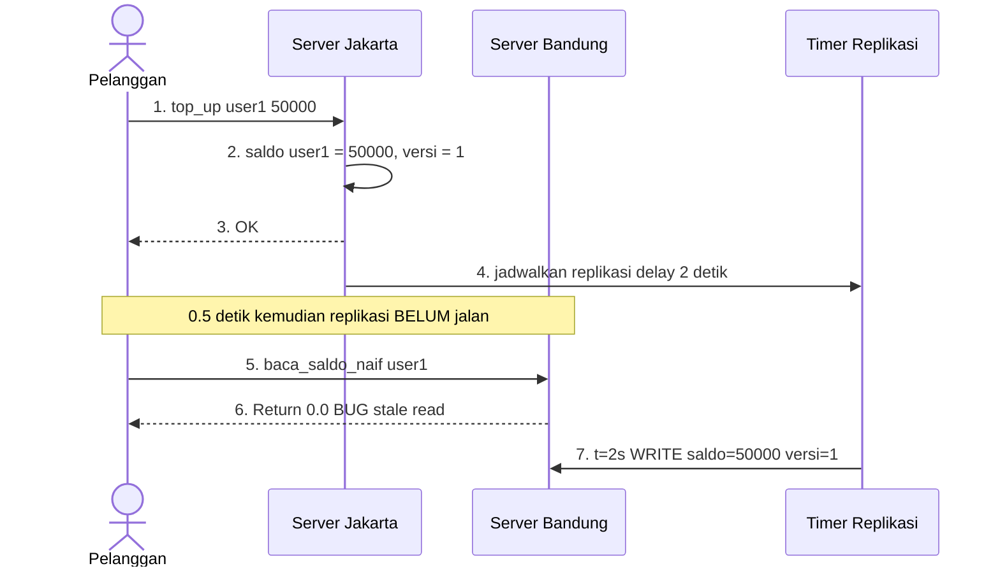
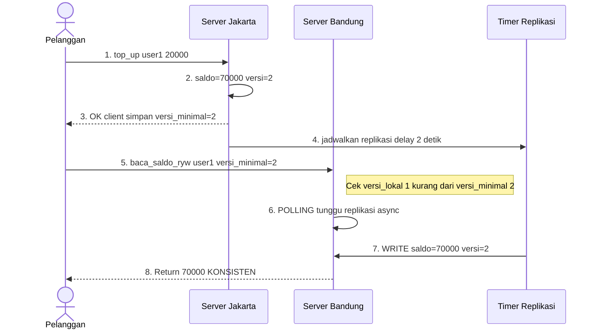

# Tugas 7 (Pekan 7) — Konsistensi Data

**Materi terkait:** Data-Centric Consistency (Sequential, Eventual), Client-Centric Consistency.

---

## Studi Kasus

Data saldo *e-wallet* pelanggan FoodGo berbeda antara server wilayah **Jakarta** dan **Bandung** karena replikasi antar server berjalan lambat. Contoh kasus nyata: pelanggan top-up saldo lewat server Jakarta, lalu dalam hitungan detik memesan makanan lewat aplikasi yang tersambung ke server Bandung — saldo belum ter-update, transaksi ditolak padahal saldo sebenarnya cukup.

---

## Bagian 1 — Analisis Konsistensi Data (Nuevalen)

> **Kontributor:** Nuevalen Refitra Alswanfo (103072430008)
> **Fokus:** Analisis Teoritis, Pemilihan Model Konsistensi, & Skenario Tambahan

### 1.1 Pemilihan Model Konsistensi: Sequential vs Eventual

#### Kesimpulan

Kasus saldo *e-wallet* FoodGo **MEMBUTUHKAN Sequential Consistency** (atau minimal jaminan *Client-Centric* yang kuat seperti *Read-Your-Writes*), dan **TIDAK CUKUP** jika hanya mengandalkan *Eventual Consistency*.

#### Argumen Berbasis Dampak Bisnis

Perbedaan fundamental antara kasus *e-wallet* dan kasus "jumlah like" di media sosial terletak pada **sifat transaksi** dan **dampak kerugian** yang ditimbulkan:

| Aspek | Saldo E-Wallet (FoodGo) | Jumlah Like (Media Sosial) |
|---|---|---|
| **Sifat data** | Finansial, presisi mutlak | Sosial, aproksimatif |
| **Toleransi inkonsistensi** | **0% (zero tolerance)** | Tinggi (±1 like tidak masalah) |
| **Dampak jika salah** | Kerugian finansial langsung, komplain pelanggan, sanksi regulasi (Bank Indonesia/OJK) | Tidak ada kerugian nyata |
| **Regulasi** | Wajib taat UU PDP, aturan *e-money* BI | Tidak ada regulasi ketat |

#### Dampak Bisnis Nyata jika FoodGo Hanya Mengandalkan Eventual Consistency

1. **Kerugian Finansial Langsung**
   Pelanggan top-up Rp100.000 di Jakarta, lalu memesan makanan Rp50.000 via server Bandung. Karena replikasi *delay* 2 detik, saldo terbaca Rp0 → transaksi ditolak. Pelanggan kehilangan waktu, kepercayaan, dan berpotensi *churn*.

2. **Risiko *Double-Spending***
   Dalam skenario terburuk, pelanggan bisa memanfaatkan celah inkonsistensi untuk memesan di dua server berbeda sebelum saldo ter-update, menyebabkan *overdraft* sistemik.

3. **Kerugian Reputasi & Regulasi**
   FoodGo sebagai platform yang memproses uang elektronik berada di bawah pengawasan Bank Indonesia (PBI No. 23/6/PBI/2021 tentang Sistem Pembayaran). Inkonsistensi saldo dapat dianggap sebagai **kegagalan sistem pembayaran** dan berujung pada denda atau pencabutan izin.

4. **Biaya *Customer Support* Membengkak**
   Setiap transaksi gagal karena *stale read* akan memicu tiket komplain. Dalam skala jutaan pengguna, ini adalah beban operasional masif.

#### Kontras dengan Kasus "Jumlah Like"

Jika jumlah like di media sosial terbaca 1000 di server A dan 999 di server B selama beberapa detik, tidak ada pelanggan yang dirugikan secara finansial. *Eventual Consistency* di sini adalah pilihan optimal karena mengutamakan *availability* dan *low latency* di atas konsistensi ketat.

> **Kesimpulan akhir:** Untuk data finansial seperti saldo *e-wallet*, **Sequential Consistency** (semua replika melihat urutan operasi yang sama) adalah keharusan — atau minimal jaminan *Client-Centric* yang kuat. *Eventual Consistency* hanya boleh dipakai untuk data non-kritis seperti riwayat pencarian, rekomendasi, atau jumlah like.

---

### 1.2 Usulan Solusi: Client-Centric Consistency — *Read-Your-Writes* (RYW)

Meskipun *Sequential Consistency* ideal, penerapannya secara global di seluruh replika FoodGo akan **menurunkan throughput** dan **meningkatkan latency** secara signifikan (karena semua *write* harus diurutkan secara global). Oleh karena itu, solusi pragmatis yang diusulkan adalah **Read-Your-Writes (RYW)** — sebuah model *Client-Centric Consistency*.

#### Prinsip Dasar

> *"Seorang klien yang baru saja melakukan write (top-up), SELALU akan membaca hasil write-nya sendiri pada read berikutnya, meskipun replika lain belum sinkron."*

#### Mekanisme Implementasi

1. **Setiap *write* menghasilkan `version_number` monotonik** (misal: `v=1, v=2, v=3...`) yang dicatat di server asal (Jakarta).
2. **Server mengembalikan `version_number` tersebut ke klien** bersama respons `OK`.
3. **Klien menyimpan `versi_minimal = version_number`** di *session*-nya (bisa di cookie, JWT claim, atau *local storage*).
4. **Pada setiap *read* berikutnya**, klien menyertakan `versi_minimal` dalam request.
5. **Server tujuan (misal: Bandung) mengecek versi lokalnya:**
   - Jika `versi_lokal >= versi_minimal` → langsung kembalikan data.
   - Jika `versi_lokal < versi_minimal` → **tunda respons** (*polling*) sampai data replikasi dari Jakarta tiba, ATAU **forward read ke Jakarta** (*read routing*).
6. **Timeout protection:** Jika replikasi tidak tiba dalam batas waktu (misal 3× `REPLICATION_DELAY`), *fallback* ke server asal agar klien tidak menunggu selamanya.

#### Perbandingan RYW vs Sequential Consistency Penuh

| Aspek | Sequential Consistency Penuh | Read-Your-Writes |
|---|---|---|
| **Konsistensi global** | ✅ Semua klien melihat urutan sama | ⚠️ Hanya menjamin konsistensi *per-klien* |
| **Throughput** | ❌ Rendah (*global ordering*) | ✅ Tinggi (replika tetap *async*) |
| **Latency read** | ❌ Tinggi (harus sinkron) | ✅ Rendah (kecuali saat RYW *trigger*) |
| **Cocok untuk e-wallet** | ✅ Ya, tapi *overkill* | ✅ Ya, **tepat sasaran** |

**RYW adalah "sweet spot"** untuk kasus FoodGo: pelanggan yang baru top-up dijamin melihat saldo terbarunya, sementara pelanggan lain yang tidak berinteraksi dengan transaksi tersebut tetap mendapat performa tinggi dari replika terdekat.

---

### 1.3 Skenario Tambahan (Di Luar FoodGo)

Untuk membuktikan bahwa pemahaman meluas di luar studi kasus FoodGo, berikut analisis singkat untuk skenario berbeda:

#### Skenario: Aplikasi Ride-Hailing (Ojek Online) — "GoRide"

**Kasus:** Seorang pelanggan membatalkan pesanan ojek di **Server Jakarta** (karena *driver* tidak datang), lalu dalam 5 detik mengecek status pesanan via aplikasi yang di-*route* ke **Server Bandung**.

**Pertanyaan:** Model konsistensi apa yang dibutuhkan?

#### Analisis

- **Bukan Eventual Consistency**
  Jika server Bandung masih menampilkan status "Driver sedang menuju lokasi" padahal pelanggan sudah membatalkan, maka:
  - Pelanggan bingung dan cemas ("Loh, kok driver masih datang? Saya sudah cancel!")
  - *Driver* tetap datang ke lokasi → biaya operasional *driver* terbuang
  - Potensi konflik fisik di lapangan antara pelanggan dan *driver*
  - Sistem mungkin tetap menagih biaya pembatalan karena status belum sinkron

- **Model yang tepat: Read-Your-Writes + Writes-Follow-Reads**
  - **RYW** menjamin pelanggan yang baru *cancel* (*write*) akan selalu membaca status "Cancelled" pada *read* berikutnya.
  - **Writes-Follow-Reads (WFR)** menjamin bahwa jika pelanggan membaca status "Searching driver" lalu melakukan *cancel*, maka *cancel* tersebut akan terlihat *setelah* status "Searching" di semua replika — mencegah anomali urutan operasi.

#### Perbedaan dengan FoodGo

| Aspek | FoodGo (E-Wallet) | GoRide (Ride-Hailing) |
|---|---|---|
| **Data kritis** | Saldo (angka presisi) | Status pesanan (*state machine*) |
| **Contoh status** | `saldo = Rp100.000` | `Searching → Matched → OnTrip → Cancelled` |
| **Toleransi inkonsistensi** | 0% | 0% |
| **Mekanisme RYW** | Berbasis `version_number` | Berbasis `state_transition_timestamp` |

**Insight:** Pola yang sama (RYW) dapat diterapkan lintas domain selama ada operasi *write-then-read* dari klien yang sama dalam selang waktu singkat. Ini adalah ciri khas aplikasi interaktif modern.

---

## Bagian 2 — Visualisasi Alur Konsistensi (Farrellino)

> **Kontributor:** Farrellino Ulung Satya Amando (103072400005)
> **Fokus:** Sequence Diagram Mermaid & Simulasi Kode

Berikut adalah *Sequence Diagram* yang menggambarkan perbedaan antara skenario *bug* (tanpa jaminan konsistensi) dan skenario *fix* (dengan *Read-Your-Writes*).

### A. Skenario NAIF — *Inconsistent Read* (BUG)

Pada skenario ini, Server Bandung langsung melayani permintaan *read* tanpa memverifikasi apakah datanya sudah sinkron dengan Server Jakarta.



### B. Skenario READ-YOUR-WRITES — Fix

Pada skenario ini, klien menyertakan `versi_minimal` yang diketahuinya. Server Bandung akan memastikan data lokalnya sudah mencapai versi tersebut sebelum mengembalikan hasil.



---

## Bagian 3 — Simulasi (Opsional, Nilai Tambah)

Skeleton `src/replica_simulation.py` mensimulasikan dua replika (Jakarta & Bandung) dengan delay replikasi buatan. TODO yang dilengkapi:

1. Menunjukkan kondisi **inconsistent read** (replika Bandung masih menunjukkan saldo lama walau Jakarta sudah update).
2. Mengimplementasikan mekanisme **Read-Your-Writes** sederhana dengan `version_number` per klien yang memperbaiki masalah tersebut.

### Cara Menjalankan

```bash
python3 src/replica_simulation.py
```

### Contoh Output

```
=== Skenario NAIF (tanpa Read-Your-Writes) ===
[Jakarta] WRITE saldo user1 = 50000.0 (versi 1)
Baca saldo dari Bandung (naif): 0.0   <-- BUG: stale read

[Jakarta] WRITE saldo user1 = 20000.0 (versi 2)
[Bandung] WRITE saldo user1 = 50000.0 (versi 1)   <-- replikasi tertunda tiba

=== Skenario dengan Read-Your-Writes ===
[Jakarta] WRITE saldo user1 = 20000.0 (versi 2)
[Bandung] WRITE saldo user1 = 20000.0 (versi 2)   <-- RYW menunggu replikasi
Baca saldo dari Bandung (RYW): 20000.0   <-- FIX: konsisten
```

---

## Struktur Submission

```
tugas-07-konsistensi-data/
├── README.md      # Analisis konsistensi + sequence diagram Mermaid
├── JURNAL.md
├── src/            # (opsional) simulasi replikasi
└── bukti/          # (jika mengerjakan simulasi) output program
```

---

## Rubrik Penilaian (Tugas 7)

| Komponen | Bobot | Kriteria |
|---|---|---|
| Ketepatan pemilihan model konsistensi | 30% | Argumen berbasis dampak bisnis nyata, bukan hafalan definisi |
| Kualitas sequence diagram | 30% | Menunjukkan jelas titik kegagalan & titik perbaikan |
| Usulan solusi client-centric | 25% | Solusi konkret dan dapat diimplementasikan (bukan wacana abstrak) |
| Proses & kontribusi kelompok | 15% | `JURNAL.md`, commit history (+ bonus jika simulasi dikerjakan) |

---

## Ringkasan Kontribusi Kelompok

| Anggota | NIM | Deliverable | Status |
|---|---|---|---|
| **Nuevalen Refitra Alswanfo** | 103072430008 | Analisis Sequential vs Eventual, usulan RYW, skenario tambahan GoRide | ✅ Selesai |
| **Farrellino Ulung Satya Amando** | 103072400005 | Sequence Diagram Mermaid (bug & fix), implementasi `replica_simulation.py` | ✅ Selesai |
| **Haniel Juanta Sembiring** | 103072400145 | Bukti output simulasi, finalisasi README, penyusunan `JURNAL.md` | ⏳ Menunggu |