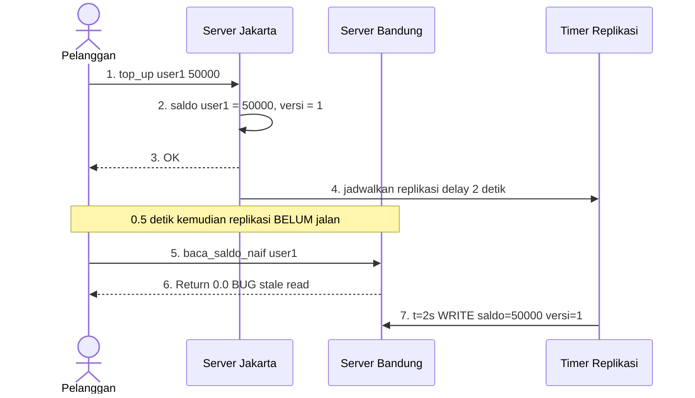
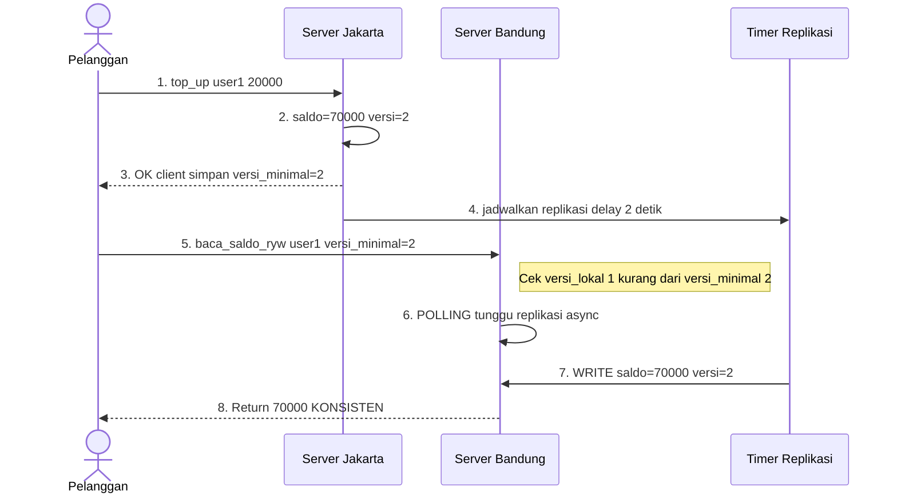

# Tugas 7 (Pekan 7) — Konsistensi Data

**Materi terkait:** Data-Centric Consistency (Sequential, Eventual), Client-Centric Consistency.

---

## Studi Kasus

Data saldo *e-wallet* pelanggan FoodGo berbeda antara server wilayah **Jakarta** dan **Bandung** karena replikasi antar server berjalan lambat. Contoh kasus nyata: pelanggan top-up saldo lewat server Jakarta, lalu dalam hitungan detik memesan makanan lewat aplikasi yang tersambung ke server Bandung — saldo belum ter-update, transaksi ditolak padahal saldo sebenarnya cukup.

---

## Bagian 1 — Analisis Konsistensi Data (Nuevalen)

> **Kontributor:** Nuevalen Refitra Alswanado (103072430008)
> **Fokus:** Analisis Teoritis, Pemilihan Model Konsistensi, & Skenario Tambahan

### 1.1 Analisis Model Konsistensi

#### Pengertian Sequential Consistency
Sequential Consistency menjamin bahwa semua operasi dari semua klien terlihat dalam satu urutan global yang konsisten dengan urutan program setiap proses. Setiap klien melihat urutan operasi yang sama, dan urutan tersebut menghormati urutan program masing-masing klien.

#### Pengertian Eventual Consistency
Eventual Consistency menjamin bahwa, jika tidak ada write baru, semua replika pada akhirnya akan konvergen ke state yang sama. Namun, selama periode konvergen, replika yang berbeda dapat mengembalikan nilai yang berbeda untuk operasi read yang sama.

#### Perbandingan Berdasarkan Kasus FoodGo
Untuk saldo e-wallet FoodGo:
- Eventual Consistency saja tidak cukup karena pengguna yang baru saja top-up mungkin langsung mencoba menggunakan saldo, dan jika di-route ke replika yang stale, transaksi bisa ditolak secara tidak benar.
- Sequential Consistency akan menyelesaikan masalah ini tetapi dengan biaya tinggi terhadap throughput dan latensi, karena setiap write harus diurutkan secara global sebelum terlihat.

#### Risiko Stale Read
Tanpa jaminan konsistensi yang tepat, pengguna yang melakukan write (top-up) lalu langsung read (cek saldo) mungkin di-route ke replika yang belum menerima update, menghasilkan stale read. Ini menyebabkan pengalaman pengguna yang buruk dan potensi kegagalan transaksi.

#### Risiko Double-Spending
Pertimbangkan skenario di mana pengguna memiliki saldo Rp100.000. Jika dua transaksi bersamaan sebesar Rp80.000 masing-masing diinisiasi pada replika berbeda sebelum replikasi selesai, kedua replika mungkin melihat saldo awal Rp100.000 dan menyetujui transaksi, menghasilkan total debit Rp160.000, yang melebihi saldo sebenarnya. Ini adalah double-spending.

**Pertanyaan analisis:** Apakah Read-Your-Writes (RYW) dapat mencegah kedua transaksi berhasil?
**Jawaban:** Tidak secara otomatis. RYW hanya menjamin bahwa seorang klien melihat hasil write-nya sendiri. Jika dua transaksi bersamaan dilakukan oleh klien yang sama dari dua sesi berbeda, atau oleh dua klien berbeda pada replika yang berbeda, RYW tidak mencegah double-spending. Pencegahan double-spending memerlukan pengendalian transaksi bersamaan (concurrency control) pada sumber data otoritatif, seperti locking, serializable transactions, atau mekanisme konsensus.

#### Pemilihan Model Konsistensi
Untuk FoodGo, kita perlu memisahkan concern:
1. **Konsistensi pembacaan saldo setelah top-up oleh pengguna yang sama:** Read-Your-Writes (RYW) cukup dan pragmatis.
2. **Konsistensi transaksi debit dan kredit:** Memerlukan konsistensi transaksional yang kuat pada sumber otoritatif untuk memastikan invariant saldo (tidak ada saldo negatif, tidak ada double-spending).
3. **Pencegahan transaksi bersamaan yang menyebabkan saldo negatif:** Memerlukan mekanisme pengendalian konkurensi (misal: locking optimis/pesimistis) pada sumber data otoritatif, bukan hanya konsistensi client-centric.

Eventual Consistency masih dapat digunakan untuk view non-otoritatif seperti dashboard analitik, proyeksi historis, atau fitur tampilan-only di mana keterlambatan kecil dapat diterima.

### 1.2 Usulan Client-Centric Consistency: Read-Your-Writes (RYW)

#### Pengertian RYW
Read-Your-Writes adalah model konsistensi client-centric yang menjamin seorang klien akan selalu melihat efek dari write-nya sendiri pada read berikutnya. Jika pengguna melakukan operasi write (misal: top-up), setiap read berikutnya oleh pengguna yang sama akan mengembalikan nilai yang mencerminkan setidaknya write tersebut.

#### Mekanisme Version Number
Setiap operasi write yang dilakukan oleh klien diberi `version_number` yang meningkat secara monotonik **per sesi pengguna** (bukan global). Versi ini dihasilkan oleh server otoritatif yang memproses write dan dikembalikan ke klien.

#### Proses Pemeriksaan Versi Replika
Ketika klien melakukan read, ia menyertakan `versi_minimal` (nomor versi dari write terakhirnya) dalam request. Replika yang melayani memeriksa versi lokalnya untuk pengguna tersebut:
- Jika `versi_lokal >= versi_minimal`, replika dapat dengan aman mengembalikan data.
- Jika `versi_lokal < versi_minimal`, replika harus menunggu hingga versi yang diperlukan direplikasi dari sumber otoritatif.

#### Polling dan Timeout
Replika melakukan polling pada penyimpanan lokalnya pada interval tetap (misal: 100-500ms) untuk memeriksa apakah versi yang diperlukan telah tiba. Timeout ditetapkan (misal: 3× delay replikasi maksimum yang diharapkan). Jika versi tidak tiba dalam timeout, polling berhenti.

#### Fallback
Jika timeout tercapai dan versi yang diperlukan masih tidak tersedia, replika **tidak boleh** mengembalikan data lama seolah-olah konsisten. Sebaliknya, ia harus:
- Mengembalikan error yang menunjukkan bahwa data belum tersedia, atau
- Meneruskan read ke sumber otoritatif (jika tersedia), atau
- Jelas mengindikasikan kepada klien bahwa data yang dikembalikan mungkin stale.

Mengembalikan data lama tanpa indikasi akan melanggar jaminan RYW dan menyesatkan pengguna.

#### Keterbatasan RYW
RYW memiliki batasan penting:
1. **Hanya menjamin konsistensi per-klien:** RYW memastikan Pengguna A melihat write-nya sendiri. Ini **TIDAK** menjamin Pengguna B akan melihat write Pengguna A segera. Misalnya, jika Pengguna A top-up, Pengguna A akan melihat saldo baru, tetapi merchant yang memeriksa saldo Pengguna A mungkin masih melihat nilai lama hingga replikasi selesai.
2. **Tidak mencegah double-spending:** Seperti dijelaskan di 1.1, RYW tidak menangani transaksi bersamaan dari klien atau sesi berbeda.
3. **Bergantung pada penyimpanan versi klien:** `versi_minimal` biasanya disimpan di sesi klien (misal: cookie, JWT claim, atau localStorage). Jika penyimpanan ini dihapus atau hilang, klien mungkin mengalami stale read hingga melakukan write baru. **localStorage bukan mekanisme keamanan atau sumber kebenaran**; ia hanya kenyamanan untuk mempertahankan state sesi.

#### Perbedaan RYW dengan Sequential Consistency
| Aspek | Sequential Consistency | Read-Your-Writes |
|---|---|---|
| **Cakupan** | Semua klien melihat urutan operasi global yang sama | Hanya menjamin klien melihat write-nya sendiri |
| **Throughput** | Rendah (karena global ordering) | Tinggi (replika tetap async) |
| **Latensi read** | Tinggi (harus sinkron global) | Rendah (kecuali saat menunggu replikasi) |
| **Kesesuaian untuk e-wallet** | Ideal tetapi mahal | Pragmatis untuk pengalaman pengguna |

RYW adalah kompromi praktis yang meningkatkan pengalaman pengguna tanpa mengorbankan throughput sistem secara keseluruhan, tetapi harus dikombinasikan dengan konsistensi transaksional yang kuat pada sumber otoritatif untuk integritas keuangan.

### 1.3 Skenario Tambahan: GoRide (Ride-Hailing)

#### Skenario Pembatalan
Seorang pelanggan membatalkan pesanan ojek di Server Jakarta karena driver tidak datang. Lima detik kemudian, pelanggan mengecek status pesanan via aplikasi yang di-route ke Server Bandung.

#### Risiko Stale Read
Jika Server Bandung belum menerima update pembatalan, ia mungkin masih menampilkan status "Searching driver" atau "Matched". Ini menyebabkan:
- Kebingungan dan kecemasan pelanggan ("Saya sudah cancel, kenapa driver masih datang?")
- Driver terus perjalanan ke lokasi, membuang waktu dan bahan bakar
- Potensi konflik antara pelanggan dan driver
- Sistem mungkin masih menagih biaya pembatalan karena status belum update

#### Penerapan RYW
Dengan RYW, pelanggan yang melakukan pembatalan (write) akan selalu melihat status "Cancelled" pada read berikutnya. Ini menyelesaikan masalah pengalaman pengguna segera untuk pelanggan yang beraksi.

#### Penerapan Writes-Follow-Reads (WFR)
Writes-Follow-Reads menjamin bahwa jika klien membaca suatu nilai lalu melakukan write, write tersebut diurutkan secara kausal setelah read. Misalnya, jika pelanggan membaca "Searching driver" lalu membatalkan, pembatalan dijamin terlihat setelah state "Searching" dalam urutan kausal untuk klien tersebut.

**Namun, WFR TIDAK menjamin bahwa semua replika langsung menampilkan status pembatalan.** WFR hanya memastikan urutan kausal untuk operasi klien tersebut. Klien lain (misal: aplikasi driver) mungkin masih melihat data stale hingga replikasi selesai.

#### Validasi Perubahan Status
Terlepas dari model konsistensi, sistem harus memvalidasi transisi status yang valid. Misalnya:
- Pesanan dengan status "Completed" tidak boleh berubah menjadi "Cancelled".
- Pesanan dengan status "Cancelled" tidak boleh berubah menjadi "OnTrip".
State machine harus divalidasi pada sumber otoritatif untuk mencegah transisi ilegal, bahkan jika replika sementara tidak konsisten.

#### Hubungan Status Pesanan dengan Notifikasi Pengemudi
Ketika pesanan dibatalkan, driver harus segera diberitahu. Jika ada keterlambatan replikasi, aplikasi driver mungkin tidak menerima notifikasi pembatalan tepat waktu, menyebabkan perjalanan yang tidak perlu. Ini memerlukan:
- Sistem push notification yang andal yang independen dari lag replikasi data.
- Aplikasi driver juga harus mengimplementasikan RYW atau WFR jika driver melakukan aksi berdasarkan status pesanan.
- Perubahan status kritis (seperti pembatalan) harus memicu notifikasi out-of-band segera kepada pihak yang terpengaruh.

#### Perbandingan dengan FoodGo
| Aspek | FoodGo (E-Wallet) | GoRide (Ride-Hailing) |
|---|---|---|
| **Data kritis** | Saldo (invariant keuangan) | Status pesanan (state machine) |
| **Risiko utama** | Double-spending, saldo negatif | Pembatalan tidak terkirim, konflik fisik |
| **Kebutuhan RYW** | Agar pengguna melihat saldo setelah top-up | Agar pengguna melihat status setelah cancel |
| **Kebutuhan konsistensi transaksional** | Wajib di sumber otoritatif untuk integritas saldo | Wajib di sumber otoritatif untuk validasi transisi status |
| **Notifikasi pihak ketiga** | Tidak selalu diperlukan | Wajib untuk pengemudi |

Kedua skenario mendapat manfaat dari RYW untuk pengalaman pengguna, tetapi FoodGo tambahan memerlukan konsistensi transaksional yang kuat untuk menegakkan invariant keuangan, sementara GoRide memerlukan validasi transisi status yang andal dan notifikasi out-of-band.

### 1.4 Evaluasi dan Trade-off

#### Kelebihan Solusi RYW
- Meningkatkan pengalaman pengguna: klien selalu melihat hasil aksinya sendiri.
- Tidak mengorbankan throughput global: replika tetap dapat melayani read secara async.
- Implementasi relatif sederhana dibandingkan konsistensi global ketat.

#### Kekurangan Solusi RYW
- Tidak menjamin konsistensi antar-klien: pengguna lain mungkin masih melihat data lama.
- Tidak mencegah double-spending atau pelanggaran invariant keuangan.
- Bergantung pada penyimpanan versi di sisi klien, yang bisa hilang atau dimanipulasi.

#### Risiko Implementasi
- Jika `versi_minimal` hilang (misal, localStorage dihapus), klien mungkin mengalami stale read.
- Timeout yang terlalu singkat dapat menyebabkan fallback ke data lama tanpa indikasi, melanggar jaminan RYW.
- Polling yang terlalu sering dapat membebani server.
- Fallback ke server otoritatif harus hati-hati agar tidak menciptakan single point of failure.

#### Kapan RYW Cocok Digunakan
- Ketika prioritas utama adalah memastikan pengguna melihat hasil aksinya sendiri (misal: posting media sosial, update profil, cek saldo setelah top-up).
- Ketika inkonsistensi antar-klien dapat ditoleransi untuk jangka waktu pendek.
- Ketika throughput dan latensi lebih penting daripada konsistensi global ketat.

#### Kapan Dibutuhkan Konsistensi Transaksional yang Lebih Kuat
- Ketika invariant keuangan harus dijaga (misal: saldo tidak boleh negatif, tidak ada double-spending).
- Ketika beberapa pengguna harus melihat view yang konsisten secara bersamaan (misal: sistem lelang, edit dokumen bersama dengan urutan ketat).
- Ketika transaksi melibatkan beberapa entitas yang harus di-commit atau rollback secara atomik.

Untuk FoodGo, sumber saldo otoritatif harus menegakkan konsistensi transaksional yang kuat dan pengendalian konkurensi. RYW dilapiskan di atasnya untuk meningkatkan pengalaman pengguna bagi klien yang beraksi, tetapi tidak menggantikan kebutuhan integritas transaksional di inti.

---

## Bagian 2 — Visualisasi Alur Konsistensi (Farrellino)

> **Kontributor:** Farrellino Ulung Satya Amando (103072400005)
> **Fokus:** Sequence Diagram Mermaid & Simulasi Kode

Berikut adalah *Sequence Diagram* yang menggambarkan perbedaan antara skenario *bug* (tanpa jaminan konsistensi) dan skenario *fix* (dengan *Read-Your-Writes*).

### A. Skenario NAIF — *Inconsistent Read* (BUG)

Pada skenario ini, Server Bandung langsung melayani permintaan *read* tanpa memverifikasi apakah datanya sudah sinkron dengan Server Jakarta.



### B. Skenario READ-YOUR-WRITES — Fix

Pada skenario ini, klien menyertakan `versi_minimal` yang diketahuinya. Server Bandung akan memastikan data lokalnya sudah mencapai versi tersebut sebelum mengembalikan hasil.



---

## Bagian 3 — Simulasi (Opsional, Nilai Tambah)

Skeleton `src/replica_simulation.py` mensimulasikan dua replika (Jakarta & Bandung) dengan delay replikasi buatan. TODO yang dilengkapi:

1. Menunjukkan kondisi **inconsistent read** (replika Bandung masih menunjukkan saldo lama walau Jakarta sudah update).
2. Mengimplementasikan mekanisme **Read-Your-Writes** sederhana dengan `version_number` per klien yang memperbaiki masalah tersebut.

### Cara Menjalankan

```bash
python3 src/replica_simulation.py
```

### Contoh Output

```
=== Skenario NAIF (tanpa Read-Your-Writes) ===
[Jakarta] WRITE saldo user1 = 50000.0 (versi 1)
Baca saldo dari Bandung (naif): 0.0   <-- BUG: stale read

[Jakarta] WRITE saldo user1 = 20000.0 (versi 2)
[Bandung] WRITE saldo user1 = 50000.0 (versi 1)   <-- replikasi tertunda tiba

=== Skenario dengan Read-Your-Writes ===
[Jakarta] WRITE saldo user1 = 20000.0 (versi 2)
[Bandung] WRITE saldo user1 = 20000.0 (versi 2)   <-- RYW menunggu replikasi
Baca saldo dari Bandung (RYW): 20000.0   <-- FIX: konsisten
```

### Hasil Pengujian & Penelusuran Eksekusi Simulasi (Haniel Juanta Sembiring)

> **Kontributor:** Haniel Juanta Sembiring (103072400145)
> **Fokus:** Pengujian Simulasi, Bukti Eksekusi (`bukti/output_simulasi.txt`), & Dokumentasi Proses

#### 1. Output Eksekusi Aktual (`src/replica_simulation.py`)

Berikut adalah hasil eksekusi program `src/replica_simulation.py` di terminal (log lengkap tersimpan pada [`bukti/output_simulasi.txt`](bukti/output_simulasi.txt)):

```text
PS D:\Semester 5\KOMPUTASI AWAN DAN TERDISTRIBUSI\komputasi-awan-dan-terdistribusi\tugas-07-konsistensi-data> py src/replica_simulation.py
=== Skenario NAIF (tanpa Read-Your-Writes) ===
[Jakarta] WRITE saldo user1 = 50000.0 (versi 1)
Baca saldo dari Bandung (naif): 0.0
[Bandung] WRITE saldo user1 = 50000.0 (versi 1)

=== Skenario dengan Read-Your-Writes ===
[Jakarta] WRITE saldo user1 = 70000.0 (versi 2)
[Bandung] WRITE saldo user1 = 70000.0 (versi 2)
Baca saldo dari Bandung (RYW): 70000.0
```

#### 2. Penelusuran Alur Kode dan Analisis Hasil Uji

1. **Skenario Naif (`baca_saldo_naif`)**
   - Saat fungsi `main()` memanggil `system.top_up("user1", 50000)`, nilai `self.version_counter` naik dari `0` menjadi `1`. Replika Jakarta langsung memperbarui saldo `user1` menjadi `50000.0` dengan versi `1` melalui `self.jakarta.write(user_id, saldo_baru, version)`.
   - Pengiriman data ke replika Bandung tidak dijalankan secara sinkron, melainkan ditunda di background menggunakan `threading.Timer(REPLICATION_DELAY, _replicate)` dengan nilai `REPLICATION_DELAY = 2.0` detik.
   - Program utama hanya menunggu selama `time.sleep(0.5)` detik lalu langsung memanggil `system.baca_saldo_naif("user1", "Bandung")`. Karena waktu tunggu `0.5` detik lebih singkat daripada delay replikasi `2.0` detik, fungsi `_replicate()` belum dijalankan oleh timer. Akibatnya, `self.bandung.read("user1")` mengambil nilai default `0.0` dari dictionary `self.saldo`.
   - Kondisi ini merepresentasikan masalah pada studi kasus FoodGo, di mana pelanggan yang baru saja top-up di server Jakarta langsung ditolak transaksinya ketika aplikasi membaca saldo dari server Bandung yang belum menerima replikasi. Baru setelah program menunggu lewat `time.sleep(REPLICATION_DELAY + 0.5)`, thread timer selesai dieksekusi dan mencetak `[Bandung] WRITE saldo user1 = 50000.0 (versi 1)`.

2. **Skenario Read-Your-Writes (`baca_saldo_read_your_writes`)**
   - Pada bagian kedua, `system.top_up("user1", 20000)` dipanggil pada objek `ReplicationSystem` yang sama. Saldo `user1` di replika Jakarta dihitung dari saldo sebelumnya ditambah nominal top-up baru (`50000.0 + 20000 = 70000.0`) dan disimpan sebagai versi `2`.
   - Klien mencatat `versi_terakhir = system.version_counter` (bernilai `2`), lalu langsung memanggil `system.baca_saldo_read_your_writes(user_id="user1", server="Bandung", versi_minimal=2)` tanpa jeda `time.sleep` di `main()`.
   - Di dalam `baca_saldo_read_your_writes()`, server Bandung mengecek versi lokalnya menggunakan kondisi `while replica.get_version(user_id) < versi_minimal:`. Saat fungsi pertama kali masuk, versi di Bandung masih `1` (dari top-up pertama), sedangkan `versi_minimal` yang diminta klien adalah `2`.
   - Karena versi di Bandung masih tertinggal, pembacaan ditahan di dalam loop dengan jeda `time.sleep(0.2)` detik sambil memantau batas waktu `timeout = REPLICATION_DELAY * 3` (`6.0` detik). Apabila hingga batas timeout replikasi belum juga tiba, fungsi memiliki mekanisme fallback `return self.jakarta.read(user_id)` agar pembacaan dialihkan ke replika Jakarta.
   - Setelah sekitar 2 detik, thread timer menyelesaikan penulisan `[Bandung] WRITE saldo user1 = 70000.0 (versi 2)`. Nilai `replica.get_version("user1")` di Bandung berubah menjadi `2`, sehingga keluar dari loop `while` dan mengembalikan saldo `70000.0` yang sudah konsisten.

| Parameter Pengujian | Skenario Naif (`baca_saldo_naif`) | Skenario Perbaikan (`baca_saldo_read_your_writes`) |
|---|---|---|
| **Operasi Write di Jakarta** | `top_up("user1", 50000)` -> Saldo `50000.0` (`versi 1`) | `top_up("user1", 20000)` -> Saldo `70000.0` (`versi 2`) |
| **Versi Lokal Bandung Saat Request Baca Masuk** | `versi 0` (belum ada data) | `versi 1` (masih memegang saldo lama `50000.0`) |
| **Penanganan di Server Bandung** | Langsung baca `self.bandung.read("user1")` tanpa cek versi | Tahan pembacaan (`polling` tiap `0.2s`) sampai `get_version >= 2` |
| **Hasil Baca Saldo di Bandung** | `0.0` (*stale read* / bug inkonsistensi) | `70000.0` (konsisten sesuai write terakhir klien) |

---

## Struktur Submission

```
tugas-07-konsistensi-data/
├── README.md      # Analisis konsistensi + sequence diagram Mermaid
├── JURNAL.md
├── src/            # (opsional) simulasi replikasi
└── bukti/          # (jika mengerjakan simulasi) output program
```

---

## Rubrik Penilaian (Tugas 7)

| Komponen | Bobot | Kriteria |
|---|---|---|
| Ketepatan pemilihan model konsistensi | 30% | Argumen berbasis dampak bisnis nyata, bukan hafalan definisi |
| Kualitas sequence diagram | 30% | Menunjukkan jelas titik kegagalan & titik perbaikan |
| Usulan solusi client-centric | 25% | Solusi konkret dan dapat diimplementasikan (bukan wacana abstrak) |
| Proses & kontribusi kelompok | 15% | `JURNAL.md`, commit history (+ bonus jika simulasi dikerjakan) |

---

## Ringkasan Kontribusi Kelompok

| Anggota | NIM | Deliverable | Status |
|---|---|---|---|
| **Nuevalen Refitra Alswanfo** | 103072430008 | Analisis Sequential vs Eventual, usulan RYW, skenario tambahan GoRide | ✅ Selesai |
| **Farrellino Ulung Satya Amando** | 103072400005 | Sequence Diagram Mermaid (bug & fix), implementasi `replica_simulation.py` | ✅ Selesai |
| **Haniel Juanta Sembiring** | 103072400145 | Bukti output simulasi, finalisasi README, penyusunan `JURNAL.md` | ✅ Selesai |