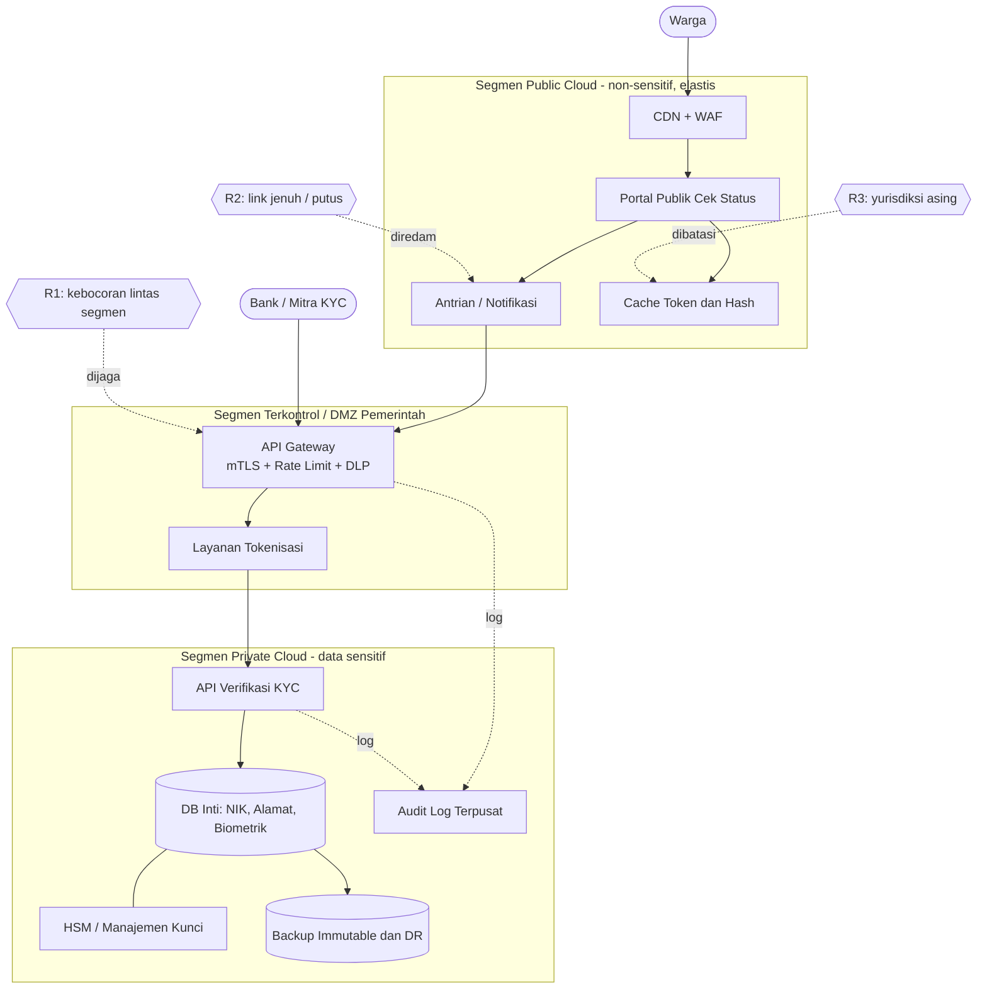

# Jurnal Proses - Tugas 9: Cloud Delivery & Deployment Model

**Kelompok:** Kelompok Sistem Terdistribusi & Komputasi Awan (Nuevalen, Galang, Haniel, Rohmatul Choirul Anam)
**Tanggal Mulai:** 20 November 2026
**Sifat:** Analisis di atas kertas, tanpa implementasi cloud

---

## Kontribusi Anggota

| Nama | NIM | Porsi Analisis | Status |
|---|---|---|---|
| Nuevalen Refitra Alswando | 103072430008 | Deployment model + 5 karakteristik NIST + tolak Public murni | Selesai |
| Galang Herjuo Mulya | 103072430006 | Service model per komponen + diagram + tolak Private murni + skenario tandingan | Selesai |
| Haniel Juanta Sembiring | 103072400145 | Pemetaan IaaS/PaaS/SaaS + batas tanggung jawab + risiko spesifik + matriks risiko + mitigasi + UU PDP | Selesai |
| Rohmatul Choirul Anam | 103072400024 | Identifikasi risiko spesifik + matriks risiko + mitigasi + diagram arsitektur | Selesai |

---

## Log Kegiatan

| Tanggal | Kegiatan | Peserta | Hasil |
|---|---|---|---|
| 20 Nov 2026 | Kick-off & pembagian tugas | Semua (Nuevalen, Galang, Haniel, Choirul) | Pembagian terlampir di `instruction.md`; menyepakati rekomendasi awal Hybrid Cloud dan pemetaan 6 komponen sistem |
| 21 Nov 2026 | Kerja individu (Deployment Model & Karakteristik NIST) | Nuevalen, Galang | Menyelesaikan analisis Bagian 1 (Hybrid Cloud & 5 karakteristik NIST), evaluasi perbandingan 4 deployment model, serta alasan penolakan Public Cloud Murni |
| 22 Nov 2026 | Kerja individu (Service Model, Risiko, UU PDP, & Diagram) | Haniel, Rohmatul Choirul Anam | Menyusun pemetaan komponen ke IaaS/PaaS/SaaS, batas tanggung jawab, 4 risiko spesifik (R1-R4), matriks risiko, kepatuhan UU PDP No. 27/2022, dan diagram Mermaid |
| 23 Nov 2026 | Review silang, penyusunan skenario tandingan, finalisasi & push | Semua (Nuevalen, Galang, Haniel, Choirul) | Melakukan review silang antar bagian, menambahkan analisis penolakan Private Cloud Murni dan 2 skenario tandingan di `README.md`, serta melengkapi `JURNAL.md` |

---

## 1. Diskusi Deployment Model
> **PIC: Nuevalen & Galang** - analisis karakteristik NIST dan pemilihan deployment model

### Opsi yang Dipertimbangkan

| Opsi | Kelebihan untuk Kasus Ini | Kekurangan | Keputusan |
|---|---|---|---|
| **Public Cloud** | Kapasitas dapat bertambah cepat sesuai kuota penyedia saat lonjakan pemilu; biaya mengikuti penggunaan (OPEX) | Kendali infrastruktur di tangan penyedia asing; risiko yurisdiksi asing dan keterbatasan kendali negara atas infrastruktur data inti | **Ditolak** |
| **Private Cloud** | Kendali penuh negara, cocok untuk NIK & biometrik; audit trail internal mendukung kepatuhan UU PDP | Penambahan kapasitas cepat dibatasi oleh cadangan internal; penambahan perangkat fisik perlu waktu dan biaya | Dipertimbangkan, tapi ditolak sebagai solusi tunggal |
| **Hybrid Cloud** | Core sensitif di private (kontrol negara), beban lonjakan non-sensitif di public (elastisitas); memadukan kerahasiaan + skalabilitas | Kompleksitas batas segmen & sinkronisasi; butuh API gateway & orkestrasi; biaya integrasi tinggi | **Dipilih** |
| **Community Cloud** | Dibagi antar instansi pemerintah (Dukcapil, Polri, Kemenkeu), tata kelola bersama, biaya dibagi | Perlu kesepakatan antar lembaga yang lama; kapasitas tetap terbatas; tidak menyelesaikan masalah lonjakan publik | Dapat jadi pelengkap, tapi bukan solusi utama |

### Alasan Pemilihan

**Kebutuhan kerahasiaan sebagai *hard constraint*:**
Biometrik (sidik jari, wajah, iris) termasuk data pribadi spesifik menurut Pasal 4 ayat (2) huruf b UU PDP. NIK tetap merupakan data pribadi yang perlu dilindungi. Kelompok menempatkan database inti di *Private Cloud* karena studi kasus mensyaratkan infrastruktur data inti berada di bawah kendali penuh negara.

**Kebutuhan skalabilitas saat lonjakan**
Pemilu dan pendaftaran sekolah dapat menaikkan trafik portal publik, sedangkan lonjakan KYC perbankan menambah beban verifikasi di segmen privat. Portal, cache, dan antrian dapat menambah kapasitas di segmen publik. Kapasitas API KYC dan database inti tetap direncanakan di segmen privat.

**Solusi: Hybrid Cloud dengan segmentasi berbasis klasifikasi data.**
- Segmen private: data biometrik, NIK, alamat lengkap, core database.
- Segmen public: portal publik, cache, CDN, antrian, dan load balancer.
- Segmen terkontrol (DMZ pemerintah): API Gateway dan layanan tokenisasi yang menangani token verifikasi, hash KYC, serta metadata transaksi.

### Bagaimana 5 Karakteristik NIST Tetap Terpenuhi

| Karakteristik NIST | Pemenuhan di Hybrid Cloud |
|---|---|
| **On-demand self-service** | Instansi pemerintah provision resource di private cloud via portal terkontrol; admin provision resource public cloud untuk beban non-sensitif |
| **Broad network access** | Instansi internal via intranet pemerintah; bank/KYC via API Gateway di DMZ pemerintah; warga via portal publik (CDN) |
| **Resource pooling** | Pooling ganda: private pool antar instansi pemerintah (multi-tenancy terawasi), public pool komersial untuk beban non-sensitif |
| **Rapid elasticity** | Portal dan antrian dapat menambah kapasitas di public cloud sesuai kuota. API KYC dapat menyesuaikan jumlah replika dalam batas kapasitas private cloud |
| **Measured service** | Metering terpisah per segmen; chargeback internal untuk private; billing penyedia untuk public; audit trail terpusat untuk kepatuhan UU PDP |

### Kesimpulan Akhir

> **Deployment model yang dipilih:** **Hybrid Cloud** dengan segmentasi berbasis klasifikasi data.
>
> **Alasan utama.** Hybrid Cloud menjaga infrastruktur data inti di bawah kendali negara dan memungkinkan kapasitas portal publik bertambah saat lonjakan. Private cloud murni juga elastis selama cadangan internal mencukupi. Dalam studi kasus ini, kelompok memilih Hybrid Cloud untuk mengurangi kebutuhan menyediakan seluruh kapasitas puncak di pusat data pemerintah. Pilihan ini menambah kompleksitas integrasi, dan layanan verifikasi tetap bergantung pada kapasitas segmen privat serta koneksi antarsegmen.

---

## 4. Diskusi Alternatif yang Ditolak (Bagian Awal)

### 4a. Public Cloud Murni - ditolak oleh Nuevalen

**Alasan 1: Pelanggaran kedaulatan data dan risiko yurisdiksi asing**
Data biometrik 280 juta warga negara adalah aset kedaulatan. Jika disimpan di public cloud penyedia asing (AWS, GCP, Azure), data tunduk pada hukum negara penyedia. **CLOUD Act AS** memungkinkan penegak hukum AS memaksa penyedia membuka data warga asing, meskipun server fisik berada di luar AS. Ini adalah risiko geopolitik yang tidak dapat diterima untuk infrastruktur kritis negara.

**Alasan 2: Kendali infrastruktur dan kewajiban UU PDP No. 27/2022**
Pasal 4 ayat (2) huruf b menggolongkan biometrik sebagai **data pribadi spesifik**. Dalam pilihan public cloud murni, lokasi pemrosesan, akses admin penyedia, dan jejak audit bergantung pada pengaturan dengan penyedia. Pemerintah tetap wajib mengamankan data dan mengawasi pihak yang terlibat dalam pemrosesan di bawah kendalinya (Pasal 35 dan Pasal 37).

Pasal 57 ayat (3) menetapkan batas maksimum denda administratif sebesar 2% dari pendapatan tahunan atau penerimaan tahunan, dengan memperhitungkan variabel pelanggaran. Ketentuan pidana pada Pasal 67-68 berlaku jika unsur tindak pidananya terpenuhi.

**Alasan 3: Vendor lock-in pada infrastruktur kritis nasional**
Sistem data kependudukan adalah critical national infrastructure. Ketergantungan pada satu penyedia public cloud menciptakan:
- Risiko pemutusan layanan akibat sanksi internasional atau kebangkrutan penyedia.
- Biaya migrasi keluar yang hampir mustahil untuk data sebesar ini.
- Ketidakpastian anggaran jangka panjang karena harga dapat berubah sepihak.

Prinsip **digital sovereignty** mengharuskan negara mempertahankan kendali penuh atas infrastruktur data kritisnya.

**Keputusan final:** Public cloud murni **ditolak total**. Namun, public cloud **dapat digunakan sebagai segmen pelengkap** dalam arsitektur hybrid, khusus untuk komponen non-sensitif (portal publik, cache, CDN) dengan batas data yang ketat (hanya token/hash, tidak ada data biometrik mentah).

---

## 2. Diskusi Service Model per Komponen
> **PIC: Haniel & Galang**

### Komponen yang Teridentifikasi
1. Database inti (NIK, alamat, biometrik)
2. API verifikasi KYC
3. Portal publik cek status
4. Notifikasi / antrian
5. Dashboard analytics
6. Backup & DR

### Perdebatan yang Muncul
- Komponen mana yang **tidak boleh** pakai SaaS sama sekali? Kenapa? -> **Database Inti Kependudukan (NIK, alamat, biometrik)**, **Layanan Verifikasi KYC / Tokenisasi**, serta **Backup & Disaster Recovery (DR)** sama sekali tidak boleh menggunakan SaaS maupun PaaS publik. Pada model SaaS, seluruh lapisan mulai dari infrastruktur, sistem operasi, mesin database, hingga aplikasi dikelola sepenuhnya oleh vendor pihak ketiga. Jika data biometrik (sidik jari, iris, wajah) dan NIK ditaruh di layanan SaaS, kendali atas akses administrator dan kunci enkripsi bergantung pada layanan penyedia. Ketergantungan tersebut tidak memenuhi syarat kendali infrastruktur data inti dalam studi kasus. Kewajiban keamanan berdasarkan Pasal 35 tetap berlaku bagi pengendali.
- Apakah API KYC lebih tepat IaaS atau PaaS? Alasan: -> Lebih tepat menggunakan **PaaS Internal (berbasis container platform / Managed Kubernetes yang berjalan di atas Private Cloud & DMZ pemerintah)**. Jika menggunakan IaaS murni, tim Dukcapil harus mengelola patching OS, konfigurasi jaringan VM, dan load balancing secara manual setiap kali ada kenaikan trafik verifikasi KYC dari perbankan. Dengan PaaS di segmen private/DMZ, kendali infrastruktur fisik tetap di tangan pemerintah, tetapi aplikasi API KYC dan layanan tokenisasi dapat di-scale secara horizontal (menambah jumlah pod/container) secara cepat serta konsisten menerapkan kebijakan mTLS, rate limiting, dan DLP.
- Apakah portal publik boleh SaaS penuh? Batasan datanya apa? -> Portal publik cek status **tidak disarankan menggunakan SaaS penuh**, melainkan lebih tepat menggunakan **PaaS (Web App Platform + Managed CDN/WAF) di segmen Public Cloud**, sedangkan model **SaaS hanya boleh dipakai secara terbatas untuk layanan pengiriman pesan notifikasi akhir** (seperti SMS/Email/WhatsApp Gateway). Batasan datanya harus mutlak: komponen di segmen publik maupun gateway SaaS **dilarang menerima atau menyimpan NIK utuh, alamat rumah, maupun data biometrik mentah**, dan hanya boleh memproses kode tiket permohonan, hash satu arah, atau pesan status umum (misalnya *"Permohonan dokumen #A982 selesai diproses"*).

### Kesimpulan Pemetaan
| Komponen | Service Model | Segmen | Alasan |
|---|---|---|---|
| **1. Database inti (NIK, alamat, biometrik)** | **IaaS** | Private Cloud (Data Center Pemerintah) | Membutuhkan kontrol penuh hingga level OS, *kernel hardening*, isolasi jaringan/storage, serta pengelolaan kunci enkripsi di HSM milik negara. |
| **2. API verifikasi KYC & Tokenisasi** | **PaaS (Internal Container Platform)** | Private Cloud & Segmen Terkontrol (DMZ) | Memudahkan *horizontal scaling* container saat trafik verifikasi bank naik tanpa harus mengurus OS per VM, sambil tetap berada di jaringan terkontrol pemerintah. |
| **3. Portal publik cek status** | **PaaS (Web Platform + Managed CDN/WAF)** | Public Cloud (Region Indonesia) | Menyerap lonjakan trafik masyarakat saat pemilu atau pendaftaran sekolah dengan *auto-scaling* cepat; hanya membaca cache token/hash tanpa menyimpan data pribadi mentah. |
| **4. Notifikasi / antrian** | **PaaS (Message Queue) + SaaS (Notification Gateway)** | Public Cloud / DMZ | Antrian PaaS meredam lonjakan request (*buffer*) agar database inti di private cloud tidak tumbang; pengiriman SMS/email status non-rahasia dapat diteruskan lewat SaaS gateway. |
| **5. Dashboard analytics** | **PaaS / SaaS Internal Pemerintah** | Private Cloud | Hanya mengolah data statistik agregat/anonim (tanpa identitas individu) untuk kebutuhan laporan instansi sehingga aman dijalankan di atas platform analitik terkelola internal. |
| **6. Backup & DR** | **IaaS** | Private Cloud Sekunder (DRC Pemerintah) | Memerlukan kendali penuh atas *block/object storage* berfitur *immutable* (WORM) dan enkripsi HSM agar cadangan data tahan terhadap serangan *ransomware*. |

---

## 3. Diskusi Risiko & Mitigasi
> **PIC: Anam & Haniel**

### Risiko yang Diangkat dalam Diskusi
| ID | Risiko Spesifik | Likelihood (1-5) | Impact (1-5) | Skor | Mitigasi |
|---|---|---|---|---|---|
| R1 | **Kebocoran data biometrik/NIK melalui antar segmen.** Misconfiguration atau bug sinkronisasi pada API gateway/DMZ membuat data mentah ikut tersalin ke segmen public cloud. | 3 | 5 | **15** | (1) Terapkan aturan ketat: data biometrik mentah dilarang keluar dari segmen private. (2) Lakukan tokenisasi atau hashing sebelum data melewati gateway. (3) Pasang DLP dan egress filtering di API gateway. (4) Gunakan mTLS dan WAF di seluruh jalur masuk. (5) Pastikan kunci enkripsi sepenuhnya dikendalikan oleh pemerintah (HSM/BYOK). (6) Catat seluruh perpindahan data dalam audit log terpusat. |
| R2 | **Link private<->public putus atau jenuh saat lonjakan** (pemilu, KYC massal), sehingga verifikasi gagal padahal beban sudah dialihkan ke public. | 4 | 4 | **16** | (1) Link dedicated (minimal 2 jalur/ISP berbeda). (2) Terapkan *Circuit breaker* dan *rate limiting* di gateway. (3) Siapkan sistem antrian dan cache token/hash di segmen public untuk menahan lonjakan trafik. (4) *Graceful degradation*: cek status tetap jalan, sementara transaksi sensitif ditunda sementara. (5) Uji beban dan simulasi failover berkala. |
| R3 | **Paparan yurisdiksi asing dan vendor lock-in di segmen public** (misal CLOUD Act; metadata/token tetap dapat diakses penyedia). | 3 | 4 | **12** | (1) Pilih penyedia/region dengan data center di Indonesia. (2) Hanya token/hash yang boleh berada di public. (3) Bangun arsitektur yang mudah dipindahkan (menggunakan container/Kubernetes dan Infrastructure as Code). (4) Exit strategy tertulis dan diuji. (5) Enkripsi dengan kunci milik sendiri. |
| R4 *(opsional)* | **Ransomware atau penyalahgunaan akses orang dalam di core private.** | 2 | 5 | **10** | (1) Zero trust dan least privilege. (2) Gunakan PAM dan MFA untuk seluruh akun admin. (3) Backup immutable yang terisolasi (DR). (4) Segmentasi jaringan internal. (5) Pantau aktivitas dan perilaku pengguna secara berkala (UEBA). |

### Matriks Risiko (ringkas)
 
| Likelihood v / Impact -> | 3 | 4 | 5 |
| ----------------------- | :-: | :-: | :-: |
| **4** | | R2 | |
| **3** | | R3 | R1 |
| **2** | | | R4 |
 
### Risiko yang Sempat Diusulkan tapi Ditolak (karena terlalu generik)
- "Hacker menyerang server" -> alasan: tidak spesifik, berlaku untuk semua sistem TI dan tidak terkait konteks hybrid maupun data kependudukan.
- "Listrik atau internet mati" -> alasan: risiko infrastruktur umum, tidak khas pada arsitektur hybrid.
- "Biaya cloud mahal" -> alasan: isu anggaran, bukan risiko keamanan atau arsitektur.

### Catatan Kepatuhan UU PDP No. 27/2022
- Biometrik tergolong data pribadi **spesifik** (Pasal 4 ayat (2) huruf b). Pengendali wajib melakukan DPIA untuk pemrosesan berisiko tinggi, termasuk pemrosesan data spesifik dan pemrosesan skala besar (Pasal 34).
- **Keamanan dan audit trail** mengacu pada kewajiban mengamankan data sesuai risiko dan merekam seluruh kegiatan pemrosesan (Pasal 31 dan Pasal 35). Audit log terpusat mendukung pencatatan tersebut.
- **Notifikasi kegagalan pelindungan data** wajib disampaikan secara tertulis kepada subjek data dan lembaga paling lambat 3x24 jam (Pasal 46). Ketentuan ini relevan dengan R1.
- **Transfer data ke luar wilayah RI (Pasal 56 ayat (2)-(4))** relevan dengan R3. Pengendali harus memastikan negara tempat penerima berkedudukan memiliki tingkat pelindungan setara atau lebih tinggi. Jika syarat itu belum terpenuhi, pengendali harus memastikan pelindungan yang memadai dan mengikat. Jika kedua syarat itu belum terpenuhi, pengendali harus memperoleh persetujuan subjek data.
- **Hak subjek data** (akses, koreksi, penghapusan) harus dapat dilayani -> memerlukan pencatatan dan pemetaan data yang jelas di segmen private.

---

## Diagram Arsitektur Konseptual
 

**Keterangan:**
- **Public:** hanya komponen non-sensitif; data yang tersimpan berupa token/hash.
- **DMZ pemerintah** menempatkan API Gateway sebagai titik kontrol lintas segmen (autentikasi, DLP, tokenisasi, rate limit).
- **Private:** seluruh data biometrik dan NIK mentah, kunci enkripsi, audit, dan backup.
- Label **R1-R3** menunjukkan titik arsitektur tempat risiko dimitigasi.

---

## 4. Ringkasan Diskusi Alternatif yang Ditolak

### 4a. Public Cloud Murni - ditolak oleh Nuevalen
- Alasan 1: **Pelanggaran kedaulatan data & risiko yurisdiksi asing** - Data NIK dan biometrik 280 juta warga yang ditaruh di penyedia cloud asing (AWS, GCP, Azure) berisiko terkena aturan ekstrateritorial seperti US CLOUD Act yang dapat memaksa penyedia membuka data meskipun server berada di luar AS.
- Alasan 2: **Kendali infrastruktur dan kewajiban UU PDP No. 27/2022** - Penempatan database inti di public cloud tidak memenuhi syarat kendali penuh negara dalam studi kasus. Pasal 35 mengatur pengamanan data dan Pasal 56 mengatur transfer lintas negara.
- Alasan 3: **Vendor lock-in pada infrastruktur kritis nasional** - Ketergantungan penuh pada satu vendor komersial menciptakan risiko penghentian layanan akibat kebijakan geopolitik/sanksi, perubahan harga sepihak, dan biaya migrasi keluar yang sangat berat bagi sistem kependudukan negara.

### 4b. Private Cloud Murni / IaaS-only - ditolak oleh Galang
- **Batas kapasitas saat lonjakan musiman** - Private cloud dapat menambah atau mengurangi kapasitas layanan dengan cepat selama cadangan internal mencukupi. Jika trafik musim pemilu atau pendaftaran sekolah melampaui cadangan tersebut, ada risiko keterlambatan atau gangguan layanan. Menyediakan cadangan untuk beban puncak membutuhkan belanja modal dan biaya operasional meski pemakaian saat hari biasa lebih rendah.
- Alasan 2 (beban operasional): **Beban pengelolaan manual tinggi jika seluruh komponen berbasis IaaS-only** - Membangun portal publik, CDN, sistem antrian pesan, dan gateway notifikasi secara manual di atas VM (IaaS) mengharuskan tim TI pemerintah mengurus patching OS, konfigurasi kluster antrian, dan penyetelan auto-scaling sendiri untuk semua lapisan. Hal ini menguras sumber daya tim teknis yang seharusnya difokuskan untuk menjaga keamanan database biometrik inti.

---

## Hasil Review Silang

| Reviewer | Bagian yang Direview | Temuan / Koreksi | Sudah Diperbaiki? |
|---|---|---|---|
| Nuevalen | Pemetaan Service Model per komponen (Bagian 2 - Haniel & Galang) | Awalnya komponen antrian dan pengiriman notifikasi digabung sebagai satu service model; disarankan memisahkan Message Queue (PaaS) sebagai buffer lonjakan dengan Notification Gateway (SaaS) yang hanya mengirim pesan status tanpa NIK/biometrik. | Sudah diperbaiki |
| Galang & Choirul | Analisis Risiko & Mitigasi (Bagian 3 - Choirul & Haniel) | Menyarankan penambahan penjelasan teknis tentang bagaimana pengecekan DPT saat Pemilu tetap bisa berjalan dari Cache Token/Hash jika link Private-Public putus (mitigasi R2 & skenario tandingan). | Sudah diperbaiki |
| Haniel | Evaluasi Karakteristik NIST & Deployment Model (Bagian 1 - Nuevalen) | Menyarankan agar bagian *Measured Service* dan *Broad Network Access* dikaitkan langsung dengan audit log terpusat UU PDP serta pemisahan jalur intranet pemerintah vs API Gateway mitra bank. | Sudah diperbaiki |

---

## Refleksi Kelompok
*(diisi bersama setelah finalisasi)*

1. Trade-off paling sulit dalam tugas ini: **kerahasiaan vs skalabilitas** - bagaimana kami menyelesaikannya: Kami menyelesaikannya dengan memisahkan arsitektur berdasarkan **klasifikasi sensitivitas data** pada model Hybrid Cloud. NIK, alamat lengkap, dan data biometrik (sidik jari, iris, wajah) ditempatkan sebagai *hard constraint* di segmen Private Cloud pemerintah di atas IaaS dengan HSM, sedangkan kebutuhan skalabilitas saat lonjakan Pemilu/PPDB dipenuhi dengan memindahkan beban halaman portal, antrian request, dan pembacaan cache token/hash satu arah ke segmen Public Cloud berbasis PaaS.
2. Hal baru yang dipahami tentang karakteristik NIST: Sebelumnya kami mengira karakteristik NIST seperti *On-Demand Self-Service*, *Resource Pooling*, dan *Rapid Elasticity* hanya berlaku pada Public Cloud komersial. Dari analisis studi kasus ini, kami memahami bahwa kelima karakteristik NIST tetap harus dipenuhi pada sistem pemerintahan, misalnya *Resource Pooling* antar ribuan instansi (Dukcapil daerah, kepolisian) di kluster Private Cloud serta *Measured Service* untuk keperluan *audit trail* kepatuhan UU PDP dan perhitungan kuota pemakaian API per instansi.
3. Kenapa satu sistem bisa punya **service model berbeda per komponen**: Karena setiap komponen dalam satu sistem memiliki profil risiko data dan pola beban trafik yang berbeda. Database biometrik membutuhkan kendali penuh sampai level OS, storage, dan kunci kriptografi sehingga wajib menggunakan **IaaS**; aplikasi API KYC dan portal cek status membutuhkan kecepatan *horizontal scaling* tanpa kerepotan mengurus OS per VM sehingga cocok menggunakan **PaaS**; sedangkan pengiriman pesan notifikasi akhir yang tidak membawa data rahasia cukup menggunakan **SaaS** agar tim tidak perlu membangun infrastruktur gateway SMS/email sendiri.
4. Yang akan kami lakukan berbeda kalau mengulang: Kami akan menyusun diagram aliran data dan klasifikasi data (data mana yang boleh keluar sebagai hash/token vs data mana yang wajib berhenti di segmen private) sejak tahap pertama diskusi sebelum membagi penulisan bagian masing-masing, sehingga pemetaan *Service Model* dan titik mitigasi risiko (`R1`-`R4`) langsung sinkron sejak draf awal.

---

## Checklist Akhir
- [x] Bagian 1 README membahas deployment model dan lima karakteristik NIST. Tabel ringkasan NIST ada di jurnal (Nuevalen).
- [x] Bagian 2 README memetakan enam komponen ke service model dan menjelaskan batas tanggung jawab (Haniel & Galang).
- [x] Bagian 3 README memuat empat risiko, matriks, mitigasi, rujukan UU PDP, dan diagram Mermaid (Anam & Haniel).
- [x] Bagian 4 README menjelaskan penolakan Public Cloud murni (Nuevalen).
- [x] Bagian 4 lanjutan dan Bagian 5 README membahas penolakan Private Cloud murni/IaaS-only dan dua skenario tandingan (Galang).
- [ ] Review silang oleh seluruh anggota. Tabel review mencatat keempat anggota, tetapi belum menunjukkan secara terpisah bagian anggota lain yang ditinjau Rohmatul Choirul Anam.
- [ ] Commit terpisah atas nama masing-masing anggota. Riwayat Git yang diperiksa belum menunjukkan commit tugas ini yang dapat diatribusikan kepada Galang.

## Log Penggunaan AI (Level 2)

> Wajib diisi sesuai kebijakan Level 2 di [`../RUBRIK-UMUM.md`](../RUBRIK-UMUM.md). Tulis "Tidak memakai AI" pada baris pertama jika memang tidak dipakai. Hanya untuk brainstorming ide/outline - bukan untuk kode/analisis/teks akhir.

| Tanggal | Tool AI | Prompt yang diberikan | Ringkasan saran/ide AI | Bagaimana diolah jadi tulisan/kode sendiri |
|---|---|---|---|---|
| ... | ... | ... | ... | ... |
