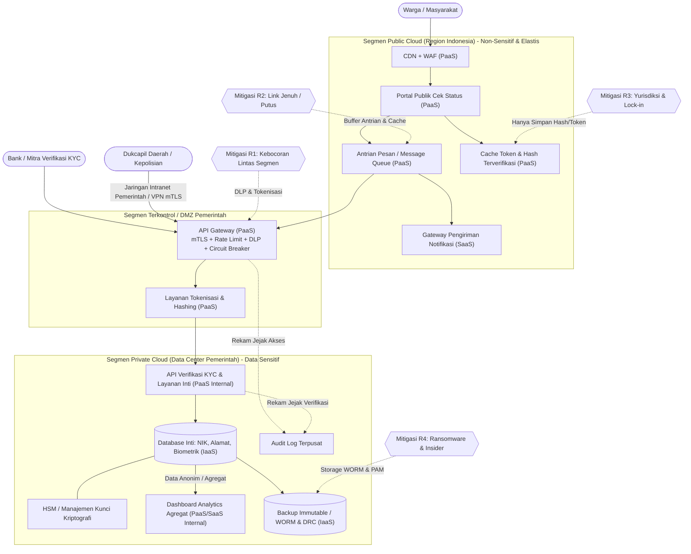

# Tugas 9 (Pekan 9) - Cloud Delivery & Deployment Model

**Materi terkait:** Karakteristik esensial cloud computing (NIST SP 800-145), Deployment Model (Public/Private/Hybrid/Community), Service Model (IaaS/PaaS/SaaS).

> Bagian 2 mata kuliah ini murni **analisis & desain di atas kertas** - tidak ada biaya cloud sama sekali, karena tugas berhenti di tahap rekomendasi, bukan implementasi nyata (implementasi baru mulai Tugas 11).

## Studi Kasus

Pemerintah ingin membangun **Sistem Data Kependudukan** (nama, NIK, alamat, data biometrik) yang:
- Sangat **rahasia** (data pribadi warga negara, diatur UU Pelindungan Data Pribadi).
- Diakses oleh **ribuan instansi** (dukcapil daerah, kepolisian, bank untuk verifikasi KYC) dengan pola akses yang **tidak rata** (lonjakan saat musim pemilu/pendaftaran sekolah).
- Butuh **skalabilitas** agar tidak downtime saat lonjakan akses, tapi **tidak boleh** datanya berada di infrastruktur yang tidak terkendali penuh oleh negara.

## Tugas Kelompok

1. **Rekomendasikan Deployment Model** (Public / Private / Hybrid / Community Cloud) yang paling tepat untuk sistem ini. Jelaskan alasannya berdasarkan **karakteristik NIST** (on-demand self-service, broad network access, resource pooling, rapid elasticity, measured service) dikaitkan dengan kebutuhan kerahasiaan vs skalabilitas.
2. **Rekomendasikan Service Model** (IaaS / PaaS / SaaS) yang tepat untuk komponen-komponen berbeda dari sistem ini (boleh berbeda service model untuk komponen berbeda, mis. database inti vs portal publik untuk pengecekan status).
3. Jelaskan **minimal 2 risiko spesifik** dari pilihan kalian dan mitigasinya (mis. jika Hybrid Cloud dipilih: risiko sinkronisasi data antara private & public segment).
4. Bandingkan singkat dengan **satu alternatif yang kalian tolak** - kenapa alternatif itu kurang tepat (mis. kenapa Public Cloud murni ditolak, atau kenapa Private Cloud murni dianggap kurang skalabel).

## Struktur Submission

```
tugas-09-cloud-delivery-deployment/
|-- README.md      # Analisis lengkap (isi dengan poin 1-4 di atas)
|-- JURNAL.md
+-- bukti/          # (opsional) diagram pendukung
```

## Rubrik Penilaian (Tugas 9)

| Komponen | Bobot | Kriteria |
|---|---|---|
| Ketepatan rekomendasi deployment model | 30% | Argumen berbasis karakteristik NIST, bukan sekadar "private cloud lebih aman" tanpa detail |
| Ketepatan rekomendasi service model | 25% | Pemetaan komponen sistem ke IaaS/PaaS/SaaS masuk akal |
| Analisis risiko & mitigasi | 25% | Risiko spesifik ke konteks data kependudukan (bukan risiko generik) |
| Perbandingan dengan alternatif yang ditolak | 20% | Argumen penolakan jelas dan berdasar |

## Batasan Penggunaan AI (Level 2)

Kebijakan **Level 2 (AI Assisted Idea Generation & Structuring)** berlaku - lihat [`../RUBRIK-UMUM.md`](../RUBRIK-UMUM.md). Boleh bertanya ke AI gambaran umum karakteristik NIST/deployment model untuk brainstorming; **tidak boleh** meminta AI menuliskan rekomendasi/analisis akhir yang tinggal ditempel ke `README.md`. Catat pemakaian AI di "Log Penggunaan AI" pada `JURNAL.md`.

- Jawaban yang terasa seperti "template" (bisa dipakai untuk sistem cloud apa saja tanpa menyebut spesifik kependudukan/data pribadi/regulasi) akan dinilai rendah pada komponen ketepatan rekomendasi.
- `README.md` wajib membahas minimal satu skenario tandingan yang kalian buat sendiri (mis. "bagaimana jika instansi daerah tidak punya infrastruktur private cloud sendiri?") beserta jawabannya.


## Bagian 1 - Rekomendasi Deployment Model (Nuevalen)

### 1.1 Rekomendasi: Hybrid Cloud dengan Segmentasi Berbasis Klasifikasi Data

Setelah menganalisis keempat opsi deployment model terhadap studi kasus Sistem Data Kependudukan, kelompok merekomendasikan **Hybrid Cloud** dengan segmentasi ketat berbasis klasifikasi data.

**Arsitektur segmentasi:**

| Segmen | Lokasi | Jenis Data | Tujuan |
|---|---|---|---|
| **Private Cloud (Government Cloud)** | Data center milik negara / pemerintah | NIK, data biometrik, alamat lengkap, data sensitif lainnya | Core database kependudukan, otoritas data primer |
| **Public Cloud** | Penyedia cloud komersial (dengan DC di wilayah Indonesia) | Data non-sensitif, cache, CDN, portal publik, antrian, load balancer | Menangani lonjakan akses, portal cek status, distribusi konten statis |
| **Secure Gateway / API Gateway** | Private segment (DMZ terkontrol) | Token verifikasi, hash KYC, metadata transaksi | Titik integrasi dengan instansi eksternal (bank, kepolisian) |

### 1.2 Justifikasi Berbasis Karakteristik Esensial NIST (SP 800-145)

Rekomendasi ini dievaluasi terhadap lima karakteristik esensial cloud computing menurut NIST:

#### 1. On-Demand Self-Service
Instansi pemerintah (dukcapil daerah, kepolisian) dapat memprovision resource komputasi untuk kebutuhan operasionalnya sendiri melalui portal terkontrol di **private cloud**, tanpa harus menunggu intervensi manual dari operator pusat. Untuk beban non-sensitif (misalnya portal publik saat musim pendaftaran sekolah), admin dapat menambah kapasitas di **public cloud** secara mandiri melalui dashboard penyedia.

#### 2. Broad Network Access
Layanan harus dapat diakses dari ribuan instansi di seluruh Indonesia melalui jaringan standar (internet/API). Hybrid cloud memungkinkan:
- Instansi internal mengakses core data via **jaringan pemerintah tertutup (Intranet Gov/Leased Line)**.
- Bank dan mitra KYC mengakses via **API Gateway** yang berada di segmen terkontrol dengan autentikasi ketat (mTLS, API key, rate limiting).
- Warga mengakses portal publik via **public cloud** yang di-front-end dengan CDN.

#### 3. Resource Pooling
- **Private cloud**: resource pooling antar instansi pemerintah dalam satu kluster terkelola, dengan multi-tenancy yang diawasi oleh otoritas pusat (Kemendagri/BSSN).
- **Public cloud**: resource pooling komersial untuk beban non-sensitif, dengan isolasi tenant yang disediakan penyedia.

Model hybrid memungkinkan pooling ganda: negara tetap punya kendali atas pool sumber daya data sensitif, sementara pool publik digunakan untuk skala.

#### 4. Rapid Elasticity (Karakteristik Penentu)
Ini adalah alasan utama hybrid dipilih. Studi kasus menyebutkan **pola akses tidak rata** dengan lonjakan saat:
- Musim pemilu (verifikasi DPT oleh KPU, partai, pengawas)
- Pendaftaran sekolah baru (verifikasi KK dan NIK orang tua)
- Lonjakan KYC perbankan di akhir tahun

Menurut [NIST SP 800-145](https://csrc.nist.gov/pubs/sp/800/145/final), *rapid elasticity* adalah kemampuan menambah dan melepas kapasitas dengan cepat mengikuti perubahan permintaan. Private cloud juga dapat melakukan *scale-out* dan *scale-in* selama masih ada kapasitas dalam kumpulan sumber daya yang tersedia. Pada studi kasus ini, Hybrid Cloud dipilih untuk menjaga kendali negara atas data inti sambil mengurangi kebutuhan menyediakan seluruh kapasitas puncak di pusat data pemerintah.

- Private cloud menangani data inti. API KYC dapat menambah atau mengurangi replika sesuai beban dalam batas kapasitas yang direncanakan.
- Public cloud menambah kapasitas portal, cache, antrian, dan CDN saat trafik meningkat, dalam batas kuota dan kapasitas layanan penyedia.
- Kapasitas database inti dan jalur antarsegmen tetap menentukan laju verifikasi yang bisa dilayani. Cache, antrian, dan pembatasan laju membantu meredam lonjakan ke segmen privat.

#### 5. Measured Service
Penggunaan resource dapat diukur dan diaudit per segmen:
- Private cloud: metering internal untuk chargeback antar instansi pemerintah.
- Public cloud: metering dari penyedia, dengan tag per proyek/instansi.
- Audit trail terpusat memungkinkan verifikasi kepatuhan terhadap UU PDP.

### 1.3 Pemenuhan Kebutuhan Studi Kasus

| Kebutuhan Studi Kasus | Bagaimana Hybrid Cloud Memenuhi |
|---|---|
| Data sangat rahasia (UU PDP) | Database inti ditempatkan di private cloud dalam negeri agar infrastruktur penyimpanannya berada di bawah kendali negara |
| Ribuan instansi dengan akses tidak rata | Public cloud menyerap lonjakan di portal, sedangkan private cloud menangani verifikasi sesuai kapasitas yang tersedia |
| Menjaga layanan saat lonjakan | Kapasitas portal dapat bertambah saat pemilu atau pendaftaran sekolah. Ketersediaan verifikasi tetap bergantung pada segmen privat dan koneksi antarsegmen |
| Infrastruktur terkendali negara | Data biometrik & NIK tidak pernah menyentuh public cloud |

### 1.4 Trade-off yang Diterima

Hybrid cloud bukan solusi sempurna. Trade-off yang diterima:
- **Kompleksitas operasional tinggi**: dua lingkungan, dua model keamanan, dua set alat monitoring.
- **Sinkronisasi data**: data yang perlu diakses dari kedua segmen (misalnya token verifikasi KYC) harus disinkronkan dengan hati-hati.
- **Biaya integrasi**: API gateway, VPN, dan orkestrasi antar segmen menambah biaya.

Namun trade-off ini **lebih dapat diterima** daripada risiko berkurangnya kendali negara atas data inti (jika memilih public cloud murni) atau risiko downtime massal saat pemilu (jika memilih private cloud murni).

---

## Bagian 4 - Alternatif yang Ditolak: Public Cloud Murni (Nuevalen)

Kelompok menolak **Public Cloud Murni** sebagai deployment model untuk Sistem Data Kependudukan. Berikut tiga alasan utama penolakan:

### Alasan 1: Kedaulatan Data dan Yurisdiksi Hukum

Data kependudukan (NIK, biometrik, alamat) adalah **aset kedaulatan negara**, bukan data komersial biasa. Jika disimpan di public cloud milik penyedia asing (AWS, GCP, Azure yang data centernya tersebar global), data tersebut tunduk pada yurisdiksi negara tempat penyedia beroperasi.

- **CLOUD Act (Amerika Serikat)** memungkinkan penegak hukum AS memaksa penyedia cloud AS membuka data warga negara asing, meskipun data tersebut disimpan di luar AS.
- **Data biometrik** (sidik jari, wajah, iris) tergolong **data pribadi spesifik** menurut UU PDP No. 27/2022 Pasal 4 ayat (2) huruf b, yang pemrosesannya memerlukan perlindungan khusus.
- Menyerahkan data biometrik 280 juta warga negara ke entitas yang tunduk pada hukum asing adalah **risiko kedaulatan yang tidak dapat diterima**.

### Alasan 2: Kendali Infrastruktur dan Kewajiban UU PDP No. 27/2022

Pengendali tetap bertanggung jawab atas pemrosesan data pribadi saat menggunakan penyedia cloud. Kewajiban berikut merujuk pada [UU No. 27 Tahun 2022 tentang Pelindungan Data Pribadi](https://jdih.komdigi.go.id/produk_hukum/view/id/832/t/undangundang%20nomor%2027%20tahun%202022).

- **Pasal 20 ayat (1) dan Pasal 28** mengharuskan pengendali memiliki dasar pemrosesan dan memproses data sesuai tujuannya.
- **Pasal 35 dan Pasal 37** mengharuskan pengendali mengamankan data sesuai risiko dan mengawasi pihak yang terlibat dalam pemrosesan di bawah kendalinya.
- **Pasal 56 ayat (2)-(4)** mengatur transfer data pribadi kepada pengendali atau prosesor di luar wilayah hukum Indonesia. Pengendali harus memastikan negara tempat penerima berkedudukan memiliki tingkat pelindungan setara atau lebih tinggi. Jika syarat itu belum terpenuhi, pengendali harus memastikan pelindungan yang memadai dan mengikat. Jika kedua syarat itu belum terpenuhi, pengendali harus memperoleh persetujuan subjek data.

Studi kasus mensyaratkan infrastruktur data inti berada di bawah kendali penuh negara. Dalam public cloud murni, lokasi pemrosesan, akses administratif, dan ketersediaan jejak audit bergantung pada layanan serta pengaturan dengan penyedia. Ketergantungan ini menjadi alasan kelompok menolak public cloud untuk database inti.

Pasal 57 ayat (3) menetapkan batas maksimum denda administratif sebesar 2% dari pendapatan tahunan atau penerimaan tahunan, dengan memperhitungkan variabel pelanggaran. Ketentuan pidana pada Pasal 67-68 berlaku jika unsur tindak pidananya terpenuhi.

### Alasan 3: Vendor Lock-In pada Infrastruktur Kritis Negara

Sistem data kependudukan adalah **infrastruktur kritis nasional** (critical national infrastructure). Jika dibangun di atas public cloud murni:

- **Ketergantungan pada satu penyedia** menciptakan risiko geopolitik (sanksi, embargo, pemutusan layanan).
- **Migrasi keluar** dari public cloud untuk data sebesar ini hampir mustahil dalam waktu singkat.
- **Harga dapat berubah sepihak** oleh penyedia, menciptakan ketidakpastian anggaran negara jangka panjang.
- **Kegagalan penyedia** (bangkrut, terkena sanksi internasional) dapat melumpuhkan layanan kependudukan nasional.

Prinsip **digital sovereignty** mengharuskan negara mempertahankan kendali penuh atas infrastruktur data kritisnya, bukan menyerahkannya pada entitas komersial asing.

### Kesimpulan Penolakan

Public cloud murni **ditolak** karena:
1. Melanggar kedaulatan data dan membuka risiko yurisdiksi asing.
2. Tidak memenuhi syarat studi kasus agar infrastruktur data inti berada di bawah kendali penuh negara.
3. Menciptakan vendor lock-in yang tidak dapat diterima untuk infrastruktur kritis negara.

Oleh karena itu, **Hybrid Cloud** dipilih sebagai kompromi: data sensitif tetap di private cloud (kendali negara penuh), sementara beban lonjakan non-sensitif dapat memanfaatkan elastisitas public cloud tanpa membahayakan kerahasiaan data inti.

---

## Bagian 2 - Rekomendasi Service Model per Komponen (IaaS / PaaS / SaaS) & Batas Tanggung Jawab (Haniel)

Dalam sistem berskala nasional seperti Sistem Data Kependudukan, penggunaan satu jenis *service model* untuk seluruh bagian sistem tidak efektif. Komponen yang menyimpan data biometrik mentah membutuhkan kontrol penuh hingga ke level sistem operasi dan perangkat keras penyimpanan, sedangkan komponen antarmuka warga membutuhkan kemudahan *auto-scaling* saat terjadi lonjakan trafik.

Berikut adalah pemetaan *service model* untuk setiap komponen utama beserta pembagian segmen dan alasannya:

### 2.1 Tabel Pemetaan Komponen Sistem ke Service Model

| No | Komponen Sistem | Service Model | Segmen Deployment | Jenis Data yang Diproses | Alasan Pemilihan |
|---|---|---|---|---|---|
| 1 | **Database Inti Kependudukan & Biometrik** | **IaaS** | Private Cloud (Data Center Pemerintah) | NIK, nama, alamat lengkap, rekaman sidik jari, iris mata, wajah | Membutuhkan kendali penuh pemerintah atas konfigurasi OS, *kernel hardening*, isolasi *storage*, dan manajemen kunci enkripsi melalui *Hardware Security Module* (HSM) milik negara tanpa berbagi *runtime* dengan pihak luar. |
| 2 | **API Verifikasi KYC & Layanan Tokenisasi** | **PaaS** (Managed Container / Kubernetes Internal) | Private Cloud & Segmen Terkontrol (DMZ) | Request validasi NIK dari bank/kepolisian, hash KYC, token respons (`VALID`/`INVALID`) | Tim pengembang pemerintah dapat fokus mengelola logika verifikasi, *rate limiting*, dan aturan *Data Loss Prevention* (DLP), sementara orkestrasi container memudahkan penambahan *replica pod* saat trafik verifikasi bank meningkat. |
| 3 | **Portal Publik Pengecekan Status** | **PaaS** (Web App Platform + Managed CDN/WAF) | Public Cloud (Data Center Region Indonesia) | Kode tiket permohonan, hash/token status pengajuan KTP/KK, aset web statis | Komponen ini menerima lonjakan trafik langsung dari masyarakat saat pemilu atau pendaftaran sekolah (PPDB). PaaS mendukung *auto-scaling* sesuai konfigurasi dan kuota layanan untuk menambah kapasitas portal saat trafik naik. |
| 4 | **Sistem Antrian Pesan & Layanan Notifikasi** | **PaaS** (Message Queue) + **SaaS** (Notification Gateway) | Public Cloud / DMZ | Payload antrian terenkripsi, nomor tujuan/email, pesan status layanan non-rahasia | Antrian berbasis PaaS bertugas sebagai *buffer* (peredam kejut) agar lonjakan request dari portal publik tidak membanjiri database inti di private cloud. Untuk pengiriman pesan pemberitahuan status ke warga (SMS/Email/WhatsApp), pemerintah dapat memakai layanan SaaS gateway karena isi pesannya tidak memuat data biometrik atau NIK penuh. |
| 5 | **Dashboard Analytics & Statistik Kependudukan** | **PaaS / SaaS Internal Pemerintah** | Private Cloud | Data agregat dan anonim (jumlah penduduk per provinsi, statistik ketersediaan layanan) | Hanya mengolah data statistik yang sudah diagregasi tanpa identitas individu. Penggunaan platform analitik siap pakai mempercepat pembuatan laporan bagi kementerian atau pemerintah daerah tanpa membahayakan privasi warga. |
| 6 | **Backup Immutable & Disaster Recovery (DR)** | **IaaS** | Private Cloud Sekunder (DRC Pemerintah Berbeda Wilayah) | Salinan terenkripsi database kependudukan dan log audit | Memerlukan kontrol langsung pada level blok penyimpanan (*block/object storage*) dengan fitur *Write-Once-Read-Many* (WORM / *immutable storage*) untuk mencegah manipulasi atau penghapusan cadangan data oleh serangan *ransomware*. |

### 2.2 Analisis Batas Tanggung Jawab (*Shared Responsibility Model*)

Pemilihan antara IaaS, PaaS, dan SaaS pada tabel di atas didasarkan pada seberapa jauh pemerintah harus memegang kendali teknis atas lapisan sistem:

1. **Pada Komponen Berbasis IaaS (Database Inti & Backup DR di Private Cloud):**
   - **Tanggung jawab tim pusat data pemerintah (penyedia infrastruktur internal):** Pengamanan fisik gedung data center, pasokan listrik, pendingin, jaringan fisik antar rak, dan lapisan hipervisor virtualisasi.
   - **Tanggung jawab tim teknis Dukcapil & BSSN (pengelola sistem):** Konfigurasi sistem operasi (Linux hardening), pengelolaan sistem berkas dan *volume encryption*, instalasi serta *patching* mesin database, pengelolaan kunci kriptografi di HSM, pengaturan hak akses *database administrator* (PAM), hingga keamanan data biometrik itu sendiri.
   - **Mengapa tidak boleh PaaS publik atau SaaS?** Pada PaaS publik maupun SaaS, lapisan sistem operasi dan mesin database dikelola oleh administrator vendor. Untuk data biometrik 280 juta penduduk, akses level *root/admin* pada mesin database tidak boleh dipegang oleh pihak komersial di luar kendali negara.

2. **Pada Komponen Berbasis PaaS (API KYC, Portal Publik, dan Message Queue):**
   - **Tanggung jawab penyedia platform:** Pemeliharaan sistem operasi host, *patching* runtime container/web server, penyediaan mekanisme *auto-scaling*, serta ketersediaan layanan antrian dan CDN.
   - **Tanggung jawab tim teknis pemerintah:** Keamanan kode aplikasi portal dan API, konfigurasi autentikasi *mutual TLS* (mTLS) untuk bank dan instansi mitra, pembatasan *rate limit* per instansi, validasi bahwa hanya token/hash yang dikirim ke segmen publik, serta pencatatan log akses.
   - **Mengapa PaaS lebih tepat dibanding IaaS untuk komponen ini?** Jika portal publik dan antrian dibangun secara manual di atas IaaS (VM biasa), tim operasional harus menyiapkan konfigurasi OS, *load balancer*, dan skrip *scaling* sendiri, sehingga waktu reaksi saat terjadi lonjakan trafik pemilu menjadi lebih lambat dan rawan kesalahan konfigurasi.

3. **Pada Komponen Berbasis SaaS (Gateway Pengiriman Notifikasi & Layanan Pendukung Non-Sensitif):**
   - **Tanggung jawab penyedia SaaS:** Seluruh tumpukan aplikasi, server, antrean pengiriman operator seluler/email, dan pemeliharaan layanan.
   - **Tanggung jawab tim teknis pemerintah:** Memastikan payload yang dikirim ke API SaaS sudah disanitasi (misalnya hanya berisi *"Permohonan dokumen dengan nomor tiket #A982 telah selesai diproses"* tanpa menyertakan NIK, alamat rumah, atau data sensitif warga).

---

## Bagian 3 - Analisis Risiko Spesifik, Mitigasi, & Kepatuhan UU PDP (Anam & Haniel)

Penggunaan arsitektur **Hybrid Cloud** untuk Sistem Data Kependudukan menimbulkan titik rawan khusus, terutama pada perbatasan antara segmen *Private Cloud* (tempat data sensitif berada) dan segmen *Public Cloud* (tempat lalu lintas publik dan lonjakan akses ditangani).

### 3.1 Identifikasi Risiko Spesifik dan Langkah Mitigasi

#### Risiko 1 (R1): Kebocoran Data Biometrik atau NIK Mentah Lintas Segmen (Private ke Public)
- **Penjelasan risiko:** Dalam arsitektur hybrid, portal publik atau layanan cache di segmen *Public Cloud* berkomunikasi dengan segmen *Private Cloud* melalui *API Gateway*. Apabila terjadi kesalahan konfigurasi (*misconfiguration*) pada endpoint API, *bug* pada layanan sinkronisasi, atau kueri yang mengembalikan seluruh kolom tabel (*over-fetching*), data NIK lengkap, alamat, atau bahkan template biometrik mentah dapat ikut terkirim dan tersimpan di cache *Public Cloud*. Jika hal ini terjadi, prinsip pembatasan data sensitif gagal dan data warga terekspos di infrastruktur komersial.
- **Langkah mitigasi:**
  1. Menerapkan layanan **Tokenisasi dan Hashing** di segmen terkontrol (DMZ) sebelum data keluar dari segmen *Private Cloud*, sehingga respons verifikasi KYC atau cek status hanya berupa nilai boolean (`VALID`/`INVALID`) atau token satu arah, bukan rekaman data asli.
  2. Memasang perangkat **Data Loss Prevention (DLP)** dan *schema validation* ketat pada *API Gateway* yang otomatis memblokir paket respons HTTP apabila terdeteksi pola 16 digit NIK atau struktur byte biometrik yang mengarah ke segmen publik.
  3. Menerapkan enkripsi *end-to-end* dengan kunci yang disimpan di dalam **HSM (Hardware Security Module)** milik pemerintah di segmen private (*Bring Your Own Key* / *Hold Your Own Key*).
  4. Mencatat seluruh transaksi lintas segmen ke dalam **Audit Log Terpusat** untuk mendeteksi anomali ukuran payload secara *real-time*.

#### Risiko 2 (R2): Kejenuhan atau Terputusnya Jalur Koneksi Private-Public Saat Lonjakan Trafik (Pemilu / PPDB)
- **Penjelasan risiko:** Meskipun segmen *Public Cloud* dapat menambah *instance* melalui *auto-scaling* saat lonjakan akses pemilu atau pendaftaran sekolah, seluruh permintaan verifikasi yang belum ada di cache pada akhirnya harus melewati jalur jaringan penghubung (*interconnect*) menuju segmen *Private Cloud*. Jika jalur penghubung ini mengalami kejenuhan *bandwidth* (*bottleneck*), latensi tinggi, atau putus, maka portal publik tetap akan gagal memproses permintaan (*timeout*), sementara database inti di segmen private bisa ikut lumpuh akibat banjir koneksi (*thundering herd*).
- **Langkah mitigasi:**
  1. Menyediakan jalur koneksi khusus (*dedicated interconnect / leased line*) yang redundan melalui minimal **dua penyedia jaringan (ISP) berbeda** antara pusat data pemerintah dan region *Public Cloud*.
  2. Menempatkan **Message Queue (Antrian Pesan)** dan **Cache Token/Hash** di segmen *Public Cloud* untuk menahan lonjakan request. Untuk kebutuhan musim pemilu (seperti pengecekan DPT), daftar hash terverifikasi yang sudah dianonimkan dapat di-*pre-warm* ke dalam cache sebelum hari pemungutan suara.
  3. Menerapkan pola **Circuit Breaker**, **Rate Limiting** bertingkat per instansi (kuota khusus untuk KPU, bank, dan kepolisian), serta mekanisme **Graceful Degradation** (pengecekan status tetap dilayani dari cache, sedangkan pengajuan perubahan data dimasukkan ke antrian asinkron).

#### Risiko 3 (R3): Paparan Yurisdiksi Hukum Asing dan Ketergantungan Teknis (Vendor Lock-In) di Segmen Public Cloud
- **Penjelasan risiko:** Walaupun segmen *Public Cloud* hanya dipakai untuk komponen non-sensitif (portal, antrian, cache token), metadata akses seperti alamat IP warga, waktu pengecekan, log trafik instansi, serta kode layanan tetap berada di infrastruktur penyedia cloud komersial. Apabila penyedia tersebut merupakan perusahaan asing yang tunduk pada regulasi ekstrateritorial (seperti *US CLOUD Act*), metadata lalu lintas kependudukan nasional berisiko diakses pihak luar. Selain itu, penggunaan layanan PaaS yang terlalu terikat pada satu vendor (*proprietary*) akan menyulitkan pemerintah saat harus memindahkan layanan publik ke penyedia lain.
- **Langkah mitigasi:**
  1. Mewajibkan pemilihan penyedia *Public Cloud* yang memiliki pusat data fisik (**Data Center Region**) di dalam wilayah hukum Republik Indonesia.
  2. Membangun layanan di segmen publik menggunakan teknologi standar terbuka, seperti container berbasis **Kubernetes** dan definisi infrastruktur berbasis **Infrastructure as Code (IaC)** (misalnya Terraform), agar layanan portal dan antrian dapat dipindahkan antar penyedia cloud dalam waktu singkat (*exit strategy* yang teruji).
  3. Melakukan pembersihan (*masking/anonymization*) pada log akses di segmen publik dan segera menarik log penting ke *Audit Log Terpusat* di segmen private.

#### Risiko 4 (R4): Serangan Ransomware atau Penyalahgunaan Hak Akses Orang Dalam (*Insider Threat*) pada Segmen Private Cloud
- **Penjelasan risiko:** Menempatkan seluruh data NIK dan biometrik di *Private Cloud* pemerintah tidak otomatis membuat data aman dari ancaman internal. Administrator sistem atau operator yang memiliki hak akses tinggi (*privileged access*) dapat menyalahgunakan wewenangnya untuk mengunduh data warga secara ilegal, atau kredensial mereka dapat dicuri untuk menyebarkan *ransomware* yang mengenkripsi database kependudukan utama.
- **Langkah mitigasi:**
  1. Menerapkan prinsip **Zero Trust** dan **Least Privilege** dengan sistem **Privileged Access Management (PAM)**, autentikasi multi-faktor (MFA), serta persetujuan ganda (*four-eyes principle*) sebelum administrator dapat mengakses server database produksi.
  2. Memisahkan penyimpanan cadangan pada infrastruktur **Backup Immutable (WORM)** yang terisolasi jaringan (*air-gapped / logically isolated*) di pusat data sekunder (DRC), sehingga data cadangan tidak dapat diubah atau dihapus meskipun akun administrator utama diretas.
  3. Menjalankan pemantauan perilaku pengguna dan entitas (**UEBA**) pada *Audit Log Terpusat* untuk mendeteksi kueri massal di luar jam kerja normal.

### 3.2 Tabel Penilaian dan Matriks Risiko

| ID | Risiko Spesifik | Likelihood (1-5) | Impact (1-5) | Skor Risiko (LxI) | Prioritas Penanganan |
|---|---|:-:|:-:|:-:|:-:|
| **R1** | Kebocoran data biometrik/NIK mentah lintas segmen akibat kesalahan konfigurasi API Gateway/sinkronisasi | 3 | 5 | **15** | Sangat Tinggi |
| **R2** | Jalur koneksi private-public jenuh atau putus saat lonjakan trafik (pemilu, PPDB, KYC massal) | 4 | 4 | **16** | Sangat Tinggi (Tertinggi) |
| **R3** | Paparan yurisdiksi hukum asing pada metadata trafik dan *vendor lock-in* di segmen public cloud | 3 | 4 | **12** | Tinggi |
| **R4** | Serangan *ransomware* atau penyalahgunaan akses oleh orang dalam (*insider threat*) di segmen private | 2 | 5 | **10** | Tinggi |

**Matriks Pemetaan Risiko (Likelihood vs Impact):**

| Likelihood v \ Impact -> | Impact 3 (Sedang) | Impact 4 (Besar) | Impact 5 (Kritis / Nasional) |
|---|:-:|:-:|:-:|
| **Likelihood 4 (Sering / Mungkin Terjadi Saat Puncak)** | - | **R2 (Skor 16)** | - |
| **Likelihood 3 (Cukup Mungkin)** | - | **R3 (Skor 12)** | **R1 (Skor 15)** |
| **Likelihood 2 (Jarang)** | - | - | **R4 (Skor 10)** |

### 3.3 Keterkaitan Risiko dan Arsitektur dengan Kepatuhan UU PDP No. 27 Tahun 2022

Mitigasi di atas mendukung pemenuhan kewajiban pelindungan data pribadi.

1. **Klasifikasi data (Pasal 4).** Biometrik termasuk data pribadi spesifik berdasarkan ayat (2) huruf b. Kombinasi data pribadi yang dapat mengidentifikasi seseorang tercantum dalam kategori data pribadi umum pada ayat (3) huruf f. NIK tetap merupakan data pribadi yang perlu dilindungi. Rancangan menempatkan NIK dan biometrik pada segmen *Private Cloud* berdasarkan syarat kendali negara dalam studi kasus.
2. **Penilaian dampak atau DPIA (Pasal 34).** Pemrosesan data biometrik dan pemrosesan data pribadi dalam skala besar termasuk pemrosesan berisiko tinggi. Pemerintah sebagai pengendali wajib menilai dampaknya terhadap subjek data. Matriks R1-R4 dapat menjadi salah satu masukan untuk penilaian tersebut.
3. **Keamanan dan rekam jejak pemrosesan (Pasal 31 dan Pasal 35).** Pengendali wajib merekam seluruh kegiatan pemrosesan data pribadi serta mengamankan data sesuai sifat dan risikonya. Audit log terpusat mendukung perekaman aktivitas di seluruh komponen pemrosesan, termasuk *API Gateway* dan layanan verifikasi KYC.
4. **Kewajiban Pemberitahuan Kegagalan Pelindungan Data (Pasal 46):** Jika terjadi insiden kebocoran (seperti pada skenario R1), pengendali data wajib memberikan pemberitahuan tertulis paling lambat **3x24 jam** kepada subjek data dan lembaga pengawas PDP. Keberadaan DLP dan audit log real-time memungkinkan deteksi dini untuk memenuhi tenggat waktu tersebut.
5. **Transfer data ke luar wilayah hukum Indonesia (Pasal 56).** Pemilihan region Indonesia mengurangi risiko transfer lintas negara. Pemerintah tetap perlu memeriksa lokasi pemrosesan, penyimpanan log dan cadangan, serta keterlibatan prosesor di luar negeri. Syarat Pasal 56 tetap berlaku jika token, hash, atau metadata yang masih dapat dikaitkan dengan seseorang ditransfer ke pengendali atau prosesor di luar wilayah hukum Indonesia.

### 3.4 Diagram Arsitektur Konseptual Hybrid Cloud



---

## Bagian 4 (Lanjutan) - Perbandingan dengan Alternatif Lain yang Ditolak: Private Cloud Murni / IaaS-Only (Galang)

Selain menolak *Public Cloud Murni*, kelompok juga menolak penggunaan **Private Cloud Murni (khususnya jika seluruh komponen dibangun di atas IaaS-Only)** sebagai arsitektur tunggal untuk Sistem Data Kependudukan.

### 4.1 Alasan Penolakan Private Cloud Murni

1. **Batas Kapasitas Saat Lonjakan Musiman**
   Akses Sistem Data Kependudukan dapat meningkat tajam saat pemilu dan pendaftaran sekolah. Private cloud dapat menambah replika dengan cepat selama kumpulan sumber dayanya masih memiliki kapasitas. Jika lonjakan melampaui cadangan yang tersedia, penambahan perangkat fisik memerlukan pengadaan dan pemasangan.
2. **Biaya Menyediakan Kapasitas Puncak**
   Menyediakan kapasitas untuk menghadapi lonjakan pemilu meningkatkan biaya belanja modal, listrik, pendingin, dan lisensi. Sebagian kapasitas berpotensi menganggur saat trafik kembali normal. Besarnya trade-off bergantung pada pola trafik, kapasitas cadangan yang dibutuhkan, dan biaya penggunaan public cloud saat puncak.
3. **Beban Operasional Tinggi jika Menggunakan Pendekatan *IaaS-Only*:**
   Apabila seluruh komponen pendukung (seperti sistem antrian, portal web, caching, dan pengiriman notifikasi) semuanya dibangun dari nol di atas mesin virtual (IaaS), tim TI pemerintah harus mengurus *patching* sistem operasi, konfigurasi kluster *message broker*, dan penyetelan *auto-scaling* secara manual untuk setiap komponen. Hal ini memecah fokus tim keamanan pemerintah yang seharusnya diprioritaskan untuk menjaga keamanan database biometrik inti.

### 4.2 Tabel Perbandingan Akhir: Hybrid Cloud (Dipilih) vs Alternatif yang Ditolak

| Aspek Evaluasi | Hybrid Cloud (Rekomendasi Kelompok) | Public Cloud Murni (Ditolak) | Private Cloud Murni / IaaS-Only (Ditolak) |
|---|---|---|---|
| **Kendali atas Infrastruktur Data Inti** | **Tinggi** - Database inti ditempatkan di pusat data pemerintah | **Lebih terbatas** - Infrastruktur data inti dikelola penyedia komersial | **Tinggi** - Seluruh komponen ditempatkan di pusat data pemerintah |
| **Kemampuan Menangani Lonjakan (*Rapid Elasticity*)** | Portal dan antrian dapat menambah kapasitas di public cloud. Verifikasi tetap bergantung pada kapasitas privat dan koneksi antarsegmen | Kapasitas dapat bertambah cepat sesuai kuota dan kapasitas layanan penyedia | Kapasitas dapat bertambah cepat selama masih ada cadangan di kumpulan sumber daya internal |
| **Efisiensi Anggaran (CAPEX vs OPEX)** | CAPEX untuk kapasitas privat terencana dan OPEX public cloud yang mengikuti pemakaian | **Efisien di Awal (OPEX)**, namun berisiko membengkak dan terkena *vendor lock-in* jangka panjang | CAPEX dapat meningkat jika kapasitas cadangan harus menampung beban puncak |
| **Ketahanan Layanan Saat Beban Puncak** | *Cache*, antrian, dan *rate limiter* mengurangi tekanan pada database inti. Verifikasi tetap bergantung pada kapasitas database dan interkoneksi | **Tinggi**, tetapi berisiko dihentikan sepihak jika terjadi masalah kontrak/geopolitik | **Rentan Downtime** - Lonjakan akses warga secara langsung dapat menghabiskan koneksi ke database inti |

---

## Bagian 5 - Analisis Skenario Tandingan / Counter-Scenario (Kelompok)

Untuk menguji ketahanan rancangan Hybrid Cloud dan pemetaan Service Model di atas terhadap kondisi nyata di lapangan, berikut adalah analisis atas dua skenario tandingan:

### 5.1 Skenario Tandingan 1: Bagaimana jika instansi Dukcapil di daerah terpencil (wilayah 3T) tidak memiliki infrastruktur Private Cloud sendiri dan koneksi internetnya sering tidak stabil?

**Permasalahan:**
Tidak semua kantor Dukcapil kabupaten/kota di Indonesia memiliki ruang server yang memadai, tenaga ahli pengelola cloud, maupun jaringan serat optik (*leased line*) yang stabil untuk menggelar *Private Cloud* di daerah masing-masing.

**Jawaban & Solusi Arsitektur:**
1. **Sentralisasi Private Cloud sebagai *Government Hub* (Kantor Daerah Sebagai *Thin Client*):**
   Pengertian *Private Cloud* pada rancangan ini **bukan** berarti setiap pemda/kabupaten wajib membangun pusat data *Private Cloud* sendiri-sendiri. Segmen *Private Cloud* diselenggarakan secara terpusat oleh pemerintah pusat (melalui Pusat Data Nasional yang memiliki redundansi antar-region di Indonesia) dengan pola tata kelola *Government Community/Private Cloud*. Kantor Dukcapil di daerah terpencil cukup mengakses layanan melalui aplikasi antarmuka ringan (*thin client* / web internal) yang terhubung ke *API Gateway* pusat menggunakan jalur **VPN Pemerintah terenkripsi (mTLS)** di atas koneksi yang tersedia (termasuk satelit/VSAT).
2. **Mekanisme *Store-and-Forward* Terenkripsi untuk Daerah Berkoneksi Putus-Sambung:**
   Untuk mengatasi kondisi ketika jaringan di daerah terpencil sedang terputus saat warga mengurus perekaman data, perangkat perekaman di kantor Dukcapil daerah dilengkapi modul **antrian lokal sementara (*local encrypted spooler*)**. Data perekaman yang masuk langsung dienkripsi secara lokal menggunakan *public key* dari HSM pusat (sehingga operator daerah sekalipun tidak dapat membuka berkas mentahnya di luar aplikasi resmi), lalu disimpan sementara di antrian lokal. Begitu koneksi VPN kembali tersambung, modul antrian lokal secara otomatis mengirim (*push*) data tersebut ke *API Gateway* pusat dan menghapus salinan lokalnya setelah menerima konfirmasi penyimpanan dari server pusat. Dengan cara ini, daerah tidak perlu menyimpan salinan database kependudukan nasional secara lokal.

### 5.2 Skenario Tandingan 2: Bagaimana jika tepat pada hari pemungutan suara Pemilu terjadi pemutusan total jalur koneksi antara segmen Public Cloud dan segmen Private Cloud?

**Permasalahan:**
Pada hari pemungutan suara, jutaan warga dan petugas TPS mengakses portal publik di segmen *Public Cloud* untuk mengecek status Daftar Pemilih Tetap (DPT). Di saat bersamaan, jalur komunikasi (*interconnect*) antara segmen *Public Cloud* dan *Private Cloud* mengalami gangguan total selama beberapa jam.

**Jawaban & Solusi Arsitektur:**
1. **Pemanfaatan *Pre-Warming Salted Hash Cache* di Segmen Public Cloud:**
   Karena daftar DPT bersifat tetap (*frozen*) sebelum hari pemungutan suara, beberapa hari sebelum hari-H sistem melakukan proses *pre-warming* ke komponen **Cache Token & Hash (PaaS)** di segmen *Public Cloud*. Data yang disalin ke cache publik **bukan** data NIK atau biometrik mentah, melainkan nilai `HMAC-SHA256(NIK + TanggalLahir, SecretSalt)` yang dipetakan ke kode TPS dan status hak pilih yang sudah disamarkan.
2. **Operasi Mandiri (*Degraded Read-Only Mode*) di Segmen Public:**
   Ketika jalur menuju *Private Cloud* terputus, *Circuit Breaker* pada *API Gateway* langsung aktif dan mengalihkan portal publik ke mode *Degraded Read-Only*. Saat warga memasukkan NIK dan tanggal lahir di portal cek DPT, aplikasi portal menghitung hash-nya dan mencocokkannya langsung dengan *Cache Token & Hash* di segmen *Public Cloud* tanpa perlu menghubungi database inti di *Private Cloud*. Dengan demikian, layanan pengecekan DPT bagi jutaan warga tetap berjalan normal 100% tanpa *downtime*, sementara permohonan perubahan data biodata baru ditampung di dalam *Message Queue* (PaaS) untuk diproses secara asinkron begitu jalur koneksi ke *Private Cloud* kembali pulih.

---

## Ringkasan Kontribusi Kelompok

| Nama | NIM | Kontribusi Utama |
|---|---|---|
| **Nuevalen Refitra Alswando** | 103072430008 | Analisis rekomendasi Deployment Model (Hybrid Cloud), evaluasi 5 karakteristik esensial NIST SP 800-145, serta analisis penolakan Public Cloud Murni |
| **Galang Herjuo Mulya** | 103072430006 | Evaluasi perbandingan opsi Deployment Model, analisis penolakan Private Cloud Murni (IaaS-Only), serta analisis skenario tandingan (*counter-scenario*) |
| **Haniel Juanta Sembiring** | 103072400145 | Pemetaan 6 komponen sistem ke Service Model (IaaS, PaaS, SaaS), analisis batas tanggung jawab (*Shared Responsibility Model*), serta pengintegrasian dokumentasi |
| **Rohmatul Choirul Anam** | 103072400024 | Identifikasi 4 risiko spesifik beserta matriks risiko dan langkah mitigasi, pemetaan kepatuhan UU PDP No. 27/2022, serta pembuatan Diagram Arsitektur Konseptual Mermaid |